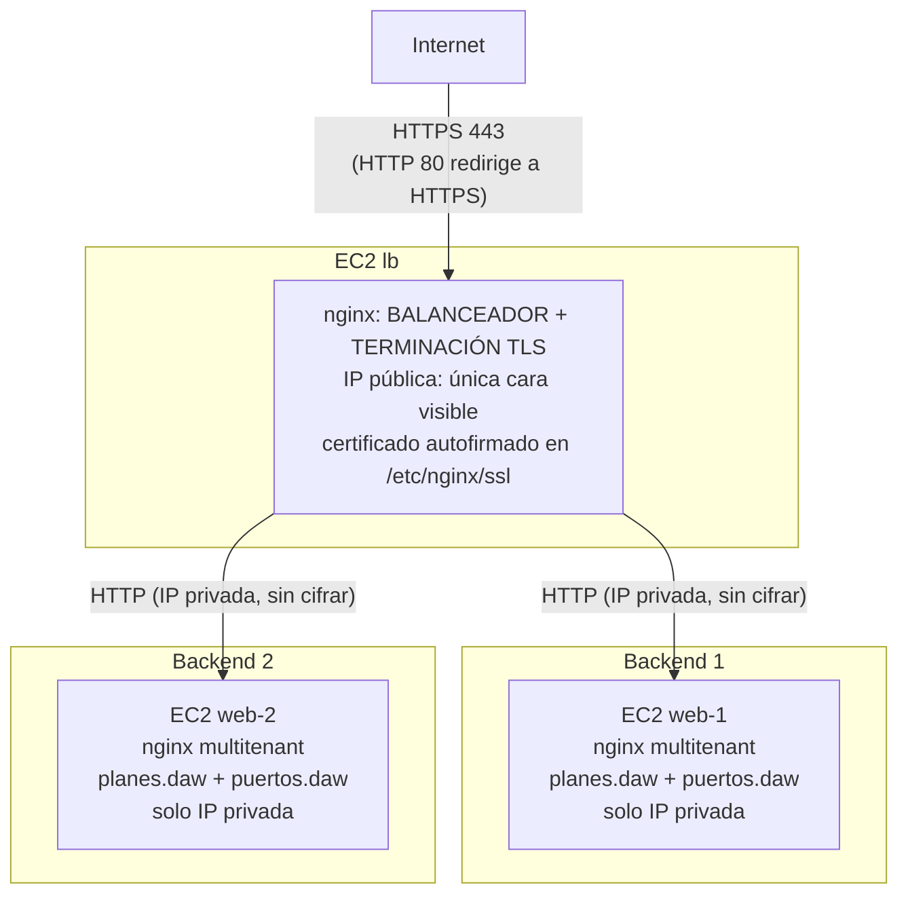

# Guía: balanceo de carga con HTTPS/SSL
backends, pero ahora el balanceador atiende a los clientes por **HTTPS** (HTTP
cifrado con TLS). Vamos a montar **a mano** el escenario que luego automatizaremos.

**Cómo leer esta guía:** después de cada comando o bloque de configuración hay un
apartado *«¿Qué significa?»* que explica línea a línea qué hace y por qué está ahí.
No copies nada sin haberlo leído antes.

## 1. El escenario que vamos a montar



El resultado final será:

- **Tres instancias EC2** con Ubuntu Server 24.04 LTS, iguales que en 1.3:
  `rundash-lb`, `rundash-web-1` y `rundash-web-2`.
- **Dos security groups**: el del balanceador ahora abre **también el puerto 443**
  (HTTPS); el de los backends es idéntico al de 1.3.
- **Un único par de claves** (.pem) compartido.
- El **escenario multitenant de la práctica 1.1** (las dos aplicaciones en
  `/var/www/planes` y `/var/www/puertos`, servidas como `planes.daw` y `puertos.daw`)
  en cada backend, igual que en 1.3.
- En el balanceador:
  - Un **certificado autofirmado** generado con `openssl`.
  - nginx escuchando en **443 (HTTPS)** con ese certificado y repartiendo entre los
    backends.
  - nginx escuchando en **80 (HTTP)** solo para **redirigir** a HTTPS.

### 1.1. ¿Por qué HTTPS? ¿Qué aporta SSL/TLS?

Hasta ahora todo el tráfico iba en **HTTP plano**: las peticiones y respuestas viajan
como texto legible por cualquiera que esté en medio de la red. **HTTPS** es HTTP
viajando dentro de un túnel cifrado (**TLS**, el sucesor de SSL). Aporta tres cosas:

| Propiedad | Qué significa |
|---|---|
| **Confidencialidad** | El contenido viaja cifrado: un intermediario no puede leerlo. |
| **Integridad** | Si alguien modifica el tráfico por el camino, el receptor lo detecta. |
| **Autenticación** | El cliente puede comprobar que habla con el servidor «verdadero» (gracias al certificado). |

Hoy en día HTTPS es el estándar: los navegadores marcan como «no seguro» cualquier
sitio HTTP plano, y muchas APIs ni siquiera aceptan HTTP.

### 1.2. ¿Qué es un certificado y por qué «autofirmado»?

Para que TLS funcione, el servidor presenta un **certificado**: un documento que
contiene su clave pública y su identidad (el nombre/IP al que sirve). La pregunta es
**quién garantiza** que ese certificado es de quien dice ser.

- **Certificado firmado por una CA** (Autoridad de Certificación): una entidad de
  confianza (Let's Encrypt, DigiCert…) verifica tu identidad y firma tu certificado.
  Los navegadores ya confían en esas CAs, así que aceptan el certificado sin protestar.
  Es lo que se usa en producción.
- **Certificado autofirmado** (*self-signed*): el propio servidor genera y firma su
  certificado, sin ninguna CA que lo avale. Cifra igual de bien, pero **nadie
  garantiza la identidad**: por eso el navegador muestra una advertencia («La conexión
  no es privada»). Es perfecto para prácticas y entornos internos, pero no para
  producción de cara al público.

En esta práctica usamos un **certificado autofirmado** porque no tenemos un dominio
real ni una CA. Generaremos el certificado con `openssl` directamente en el
balanceador. En producción se usaría Let's Encrypt (gratis) o AWS Certificate
Manager; lo mencionamos al final.

### 1.3. «Terminación TLS» en el balanceador

Fíjate en el diagrama: el cifrado va **solo entre el cliente y el balanceador**. Del
balanceador a los backends el tráfico vuelve a ser HTTP plano. Esto se llama
**terminación TLS** (*TLS termination*): el balanceador es quien «termina» (descifra)
la conexión cifrada y habla en claro con los backends.

Ventajas: los backends no necesitan certificado ni gastan CPU cifrando, y podemos
cambiar/renovar el certificado en un único sitio (el balanceador). Es el esquema más
habitual.

### 1.4. Conceptos nuevos

| Concepto | Qué es |
|---|---|
| **TLS/SSL** | Protocolos de cifrado. TLS es el moderno; «SSL» se usa por costumbre. |
| **HTTPS** | HTTP sobre TLS. Puerto estándar: **443**. |
| **Certificado** | Documento con la clave pública y la identidad del servidor. |
| **Certificado autofirmado** | Certificado firmado por el propio servidor, sin CA. El navegador avisa. |
| **Terminación TLS** | El proxy descifra el HTTPS y habla en HTTP plano con los backends. |
| **Redirección 301** | Respuesta que dice «esto se ha movido permanentemente a esta otra URL». La usamos para pasar de HTTP a HTTPS. |

> Región de trabajo: **us-east-1 (N. Virginia)**, como siempre.

## 2. Requisitos previos

- Cuenta de AWS con permisos para crear instancias EC2, security groups y key pairs.
  Vale la capa gratuita (free tier).
- Cliente SSH, `curl` y `openssl` instalados (`openssl` viene de serie en
  Linux/macOS; en Windows usa WSL).
- Haber hecho (o entender) las prácticas 1.1, 1.2 y 1.3. Los backends son idénticos
  a los de 1.3; el balanceador es el de 1.3 más la capa SSL.

## 3. Crear el key pair y los dos security groups

Como en 1.2/1.3, creamos primero el key pair y los security groups.

### 3.1. Key pair

1. **Network & Security → Key Pairs → Create key pair**:
   - Name: `rundash-lbssl-key`, tipo **RSA**, formato **.pem**.
2. Descarga `rundash-lbssl-key.pem` y protégelo:

```bash
chmod 600 rundash-lbssl-key.pem
```

### 3.2. Security group del balanceador (ahora con HTTPS)

3. **Create security group**:
   - Name: `rundash-lbssl-sg`
   - Description: `SSH, HTTP y HTTPS para el balanceador de carga`
   - VPC por defecto. Reglas de entrada:

     | Tipo  | Puerto | Origen      | Descripción |
     |-------|--------|-------------|-------------|
     | SSH   | 22     | `0.0.0.0/0` | SSH         |
     | HTTP  | 80     | `0.0.0.0/0` | HTTP        |
     | HTTPS | 443    | `0.0.0.0/0` | HTTPS       |

   La novedad respecto a 1.3 es la regla **HTTPS (443)**: sin ella, el tráfico
   cifrado no podría entrar. Dejamos también el 80 abierto porque lo usaremos para
   redirigir a HTTPS.

### 3.3. Security group de los backends

4. **Create security group**:
   - Name: `rundash-lbssl-backend-sg`
   - Description: `SSH desde cualquier sitio y HTTP solo desde el balanceador`
   - VPC por defecto. Reglas de entrada:

     | Tipo | Puerto | Origen                              | Descripción                  |
     |------|--------|-------------------------------------|------------------------------|
     | SSH  | 22     | `0.0.0.0/0`                         | SSH                          |
     | HTTP | 80     | `rundash-lbssl-sg` (el grupo)    | HTTP solo desde el balanceador |

   En la regla HTTP, en **Source** escribe `rundash-lbssl-sg` y selecciónalo.

Los backends **no** necesitan el puerto 443: recuerdan que el cifrado termina en el
balanceador, así que a los backends se les habla en HTTP plano por el puerto 80.

## 4. Lanzar las tres instancias

Igual que en 1.3: primero los dos backends, luego el balanceador.

### 4.1. Backend 1 (`rundash-web-1`)

1. **Launch instance**:
   - **Name**: `rundash-web-1`
   - **AMI**: Ubuntu Server 24.04 LTS (x86_64).
   - **Instance type**: `t2.small`.
   - **Key pair**: `rundash-lbssl-key`.
   - **Network settings → Edit**: security group `rundash-lbssl-backend-sg`.
   - **Configure storage**: 8 GiB gp3.
   - **Advanced details → User data**:

     ```yaml
     #cloud-config
     hostname: rundash-web-1
     package_update: true
     packages:
       - python3
       - python3-apt
     ```
2. **Launch instance**.

### 4.2. Backend 2 (`rundash-web-2`)

3. Repite con **Name** `rundash-web-2` y user data:

     ```yaml
     #cloud-config
     hostname: rundash-web-2
     package_update: true
     packages:
       - python3
       - python3-apt
     ```

### 4.3. Balanceador (`rundash-lb`)

4. **Launch instance**:
   - **Name**: `rundash-lb`
   - **AMI**: Ubuntu Server 24.04 LTS (x86_64).
   - **Instance type**: `t2.small`.
   - **Key pair**: `rundash-lbssl-key`.
   - **Network settings → Edit**: security group `rundash-lbssl-sg`.
   - **Configure storage**: 8 GiB gp3.
   - **Advanced details → User data**:

     ```yaml
     #cloud-config
     hostname: rundash-lb
     package_update: true
     packages:
       - python3
       - python3-apt
     ```
5. **Launch instance**.

### 4.4. Anotar las direcciones

Cuando las tres estén `running`, anota:

- **Public IPv4 address** del balanceador → `<IP_LB>`.
- **Private IPv4 address** de `rundash-web-1` → `<IP_PRIV_WEB1>`.
- **Private IPv4 address** de `rundash-web-2` → `<IP_PRIV_WEB2>`.

## 5. Configurar los dos backends

Los backends son **idénticos a los de la práctica 1.3**: el escenario multitenant de
la 1.1 (dos aplicaciones, cada una con su virtual host) **más** la cabecera
`X-Served-By`. Repetimos los pasos para que la práctica sea autocontenida.

Conecta al backend 1:

```bash
ssh -i rundash-lbssl-key.pem ubuntu@<IP_PUB_WEB1>
```

```bash
cloud-init status --wait
sudo apt update
sudo apt install -y nginx git
```

Clona las dos aplicaciones, cada una en su directorio:

```bash
sudo git clone https://github.com/raul-profesor/rundash.git /var/www/planes
sudo git clone https://github.com/raul-profesor/puertos-tour.git /var/www/puertos
```

Crea un virtual host por tenant. Primero `planes.daw`:

```bash
sudo nano /etc/nginx/sites-available/planes.daw
```

```nginx
server {
    listen 80;
    listen [::]:80;
    server_name planes.daw;

    root /var/www/planes;
    index index.html;

    add_header X-Served-By $hostname always;

    location / {
        try_files $uri $uri/index.html $uri/ =404;
    }
}
```

Y luego `puertos.daw`:

```bash
sudo nano /etc/nginx/sites-available/puertos.daw
```

```nginx
server {
    listen 80;
    listen [::]:80;
    server_name puertos.daw;

    root /var/www/puertos;
    index index.html;

    add_header X-Served-By $hostname always;

    location / {
        try_files $uri $uri/index.html $uri/ =404;
    }
}
```

Guarda ambos, activa los dos sitios, desactiva el de ejemplo y valida:

```bash
sudo ln -s /etc/nginx/sites-available/planes.daw /etc/nginx/sites-enabled/planes.daw
sudo ln -s /etc/nginx/sites-available/puertos.daw /etc/nginx/sites-enabled/puertos.daw
sudo rm /etc/nginx/sites-enabled/default
sudo nginx -t
sudo systemctl reload nginx
sudo systemctl enable nginx
```

Comprueba, forzando la cabecera `Host`, que el backend sirve el sitio y se identifica:

```bash
curl -sI -H "Host: planes.daw" http://localhost/ | grep -i x-served-by
```

Debe dar `X-Served-By: rundash-web-1`.

Sal y **repite todo el apartado 5 en el backend 2** (`rundash-web-2`).

## 6. Configurar el balanceador con SSL

Conecta al balanceador:

```bash
ssh -i rundash-lbssl-key.pem ubuntu@<IP_LB>
```

### 6.1. Instalar nginx

```bash
cloud-init status --wait
sudo apt update
sudo apt install -y nginx
```

### 6.2. Generar el certificado autofirmado

Crea un directorio para guardar el certificado y genéralo con `openssl`:

```bash
sudo mkdir -p /etc/nginx/ssl
sudo chmod 700 /etc/nginx/ssl
```

```bash
sudo openssl req -x509 -nodes -days 365 -newkey rsa:2048 \
  -keyout /etc/nginx/ssl/rundash.key \
  -out /etc/nginx/ssl/rundash.crt \
  -subj "/C=ES/ST=Madrid/L=Madrid/O=DEAW-UD1/CN=<IP_LB>" \
  -addext "subjectAltName=IP:<IP_LB>"
```

Sustituye `<IP_LB>` por la IP pública del balanceador (aparece dos veces).

**¿Qué significa cada opción?**

| Opción | Significado |
|---|---|
| `req -x509` | Genera un certificado X.509 (el formato estándar) **autofirmado**. `-x509` es lo que lo hace autofirmado en vez de una petición a una CA. |
| `-nodes` | No cifra la clave privada con una frase de contraseña (*no DES*). Si la cifráramos, nginx pediría la contraseña al arrancar, lo cual no es viable en un servidor. |
| `-days 365` | El certificado será válido un año. Pasado ese plazo, los navegadores lo darán por caducado. |
| `-newkey rsa:2048` | Genera a la vez una clave privada nueva, RSA de 2048 bits. |
| `-keyout /etc/nginx/ssl/rundash.key` | Dónde guardar la **clave privada** (el secreto; solo debe leerla root/nginx). |
| `-out /etc/nginx/ssl/rundash.crt` | Dónde guardar el **certificado** (la parte pública). |
| `-subj "/C=ES/..."` | Los datos de identidad del certificado (país, región, organización y `CN` = *Common Name*, el nombre al que sirve). Aquí ponemos la IP del balanceador como `CN`. |
| `-addext "subjectAltName=IP:<IP_LB>"` | Añade una extensión **SAN** (*Subject Alternative Name*) con la IP. Los navegadores modernos validan el nombre contra el SAN, no contra el CN; por eso es importante que la IP aparezca aquí. |

Al terminar tendrás dos ficheros: `rundash.key` (clave privada) y `rundash.crt`
(certificado). Puedes inspeccionar el certificado con:

```bash
openssl x509 -in /etc/nginx/ssl/rundash.crt -noout -subject -dates -ext subjectAltName
```

> **¿Por qué autofirmado y no Let's Encrypt?** Let's Encrypt necesita un nombre de
> dominio real y demostrar que lo controlas (normalmente vía DNS o HTTP). Como aquí
> accedemos por una IP efímera y no tenemos dominio, lo práctico es autofirmar. El
> cifrado es el mismo; lo único que falta es la garantía de identidad de una CA (por
> eso el navegador avisa).

### 6.3. Configurar nginx con SSL

```bash
sudo nano /etc/nginx/sites-available/rundash-lb-ssl
```

Pega este contenido, sustituyendo `<IP_PRIV_WEB1>` y `<IP_PRIV_WEB2>`:

```nginx
upstream rundash_backend {
    server <IP_PRIV_WEB1>:80 max_fails=2 fail_timeout=30s;
    server <IP_PRIV_WEB2>:80 max_fails=2 fail_timeout=30s;
}

server {
    listen 80;
    listen [::]:80;
    server_name _;

    return 301 https://$host$request_uri;
}

server {
    listen 443 ssl;
    listen [::]:443 ssl;
    server_name _;

    ssl_certificate     /etc/nginx/ssl/rundash.crt;
    ssl_certificate_key /etc/nginx/ssl/rundash.key;
    ssl_protocols TLSv1.2 TLSv1.3;

    location / {
        proxy_pass http://rundash_backend;
        proxy_connect_timeout 3s;
        proxy_send_timeout 10s;
        proxy_read_timeout 10s;
        proxy_next_upstream error timeout http_502 http_503 http_504;
        proxy_set_header Host $host;
        proxy_set_header X-Real-IP $remote_addr;
        proxy_set_header X-Forwarded-For $proxy_add_x_forwarded_for;
        proxy_set_header X-Forwarded-Proto $scheme;
    }
}
```

**¿Qué significa cada parte?**

| Parte | Significado |
|---|---|
| `upstream rundash_backend { ... }` | Igual que en 1.3: el grupo de backends entre los que repartir, con `max_fails`/`fail_timeout` para detectar caídas y excluir de la rotación a un nodo que falla. |
| Primer `server` (`listen 80`) | Atiende el puerto 80 (HTTP) **solo para redirigir**. |
| `return 301 https://$host$request_uri;` | Devuelve una redirección permanente (301) a la misma URL pero en `https`. `$host` es el nombre/IP pedido y `$request_uri` la ruta y parámetros originales. Así, quien entre por HTTP acaba automáticamente en HTTPS. |
| Segundo `server` (`listen 443 ssl`) | El sitio HTTPS. La palabra `ssl` indica que este puerto habla TLS. |
| `ssl_certificate /etc/nginx/ssl/rundash.crt;` | El certificado que nginx presenta a los clientes. |
| `ssl_certificate_key /etc/nginx/ssl/rundash.key;` | La clave privada asociada. nginx la necesita para el handshake TLS. |
| `ssl_protocols TLSv1.2 TLSv1.3;` | Qué versiones de TLS se aceptan. Permitimos las dos modernas y excluimos las antiguas e inseguras (TLS 1.0/1.1, SSLv3). |
| `proxy_connect_timeout 3s;` / `proxy_next_upstream ...;` | Igual que en 1.3: detectar rápido un backend caído (3 s en vez de los 60 s por defecto) y reintentar la petición en el otro sin que el cliente lo note. |
| `location / { proxy_pass http://rundash_backend; ... }` | Igual que en 1.3: reparte entre los backends por round-robin y pasa las cabeceras. Observa que a los backends se les habla en `http://` plano (terminación TLS). |

> Nota: `proxy_set_header X-Forwarded-Proto $scheme;` ahora es especialmente útil:
> `$scheme` será `https`, y así los backends saben que el cliente llegó cifrado
> aunque ellos reciban HTTP plano.

Guarda (`Ctrl+O`, `Enter`, `Ctrl+X`).

Activa el sitio, desactiva el de ejemplo y valida:

```bash
sudo ln -s /etc/nginx/sites-available/rundash-lb-ssl /etc/nginx/sites-enabled/rundash-lb-ssl
sudo rm /etc/nginx/sites-enabled/default
sudo nginx -t
sudo systemctl reload nginx
sudo systemctl enable nginx
```

`nginx -t` debe decir `syntax is ok`. Si falla mencionando el certificado, revisa que
las rutas de `ssl_certificate` y `ssl_certificate_key` sean exactamente las de los
ficheros que creaste en 6.2.

## 7. Verificación final

### 7.1. Resolver los dominios hacia el balanceador

Como en las prácticas anteriores, tu máquina local necesita resolver `planes.daw` y
`puertos.daw`. Ahora **apuntan al balanceador** (su IP pública), que es quien termina
el TLS y reparte entre los backends. Añade en el `/etc/hosts` de tu máquina:

```text
<IP_LB>  planes.daw puertos.daw
```

(En Linux/macOS `sudo nano /etc/hosts`; en Windows el Bloc de notas como
administrador en `C:\Windows\System32\drivers\etc\hosts`.)

#### Alternativa: hacer las comprobaciones con Docker

Si no tienes permisos para modificar el `/etc/hosts` de tu máquina, puedes ejecutar
las comprobaciones desde un contenedor. Docker añadirá los nombres solo al fichero
`/etc/hosts` de ese contenedor; no se modifica la configuración del equipo anfitrión.
Sustituye `<IP_LB>` por la IP pública real del balanceador:

```bash
docker run --rm -it \
  --add-host planes.daw:<IP_LB> \
  --add-host puertos.daw:<IP_LB> \
  alpine:3.22 sh
```

Dentro del contenedor, instala las herramientas de comprobación:

```sh
apk add --no-cache curl openssl
```

Ahora ejecuta **dentro del contenedor** los comandos de las secciones 7.2, 7.4, 7.5
y 7.6 tal como aparecen; los nombres `planes.daw` y `puertos.daw` resolverán a la IP
del balanceador. Al terminar, escribe `exit`: Docker eliminará el contenedor.

Esta alternativa permite comprobar HTTPS, la redirección HTTP, el reparto entre
backends y el certificado. La comprobación visual del navegador de la sección 7.3
requiere que el navegador también pueda resolver esos nombres; la entrada `--add-host`
solo es visible dentro del contenedor.

### 7.2. HTTPS funciona

Desde tu máquina local (o dentro del contenedor de la alternativa Docker):

```bash
curl -kI https://planes.daw
```

Debe dar `HTTP/1.1 200 OK`.

**¿Qué es `-k`?** Viene de *insecure*: le dice a `curl` que **no valide** el
certificado. Como es autofirmado, si no pusiéramos `-k`, `curl` rechazaría la
conexión con un error de certificado. Con `-k` aceptamos el certificado «a ciegas»
(para la práctica). El cifrado sigue activo; solo nos saltamos la comprobación de
identidad.

### 7.3. El navegador avisa (y es normal)

Abre `https://planes.daw` en el navegador. Verás una advertencia tipo «La conexión no
es privada» / «Riesgo de seguridad». **Es el comportamiento esperado**: el certificado
es autofirmado (nadie lo avala) y además está emitido para la IP del balanceador, no
para `planes.daw`. Puedes aceptar el riesgo (en Firefox: «Avanzado… → Aceptar el
riesgo y continuar»; en Chrome: «Configuración avanzada → Continuar…») y verás RunDash
sobre HTTPS. Repite con `https://puertos.daw`: el mismo balanceador sirve el otro
sitio, también cifrado.

### 7.4. HTTP redirige a HTTPS

```bash
curl -sI http://planes.daw | head -5
```

Debe devolver `HTTP/1.1 301 Moved Permanently` y una cabecera
`Location: https://planes.daw/`. Es el primer `server` redirigiendo. Si quieres seguir
la redirección automáticamente:

```bash
curl -kLsI http://planes.daw | grep -i '^HTTP'
```

Verás primero el `301` y luego el `200` de la respuesta HTTPS final.

### 7.5. El reparto sigue funcionando

```bash
for i in $(seq 1 6); do curl -kIs https://planes.daw | grep -i x-served-by; done
```

El valor debe alternar entre `rundash-web-1` y `rundash-web-2`, igual que en 1.3. El
balanceo no se ve afectado por el cifrado.

### 7.6. Inspeccionar el handshake (opcional)

```bash
echo | openssl s_client -connect planes.daw:443 2>/dev/null | grep -E 'subject=|issuer=|Verification'
```

Verás que `subject` e `issuer` son iguales (señal de autofirmado: el emisor es el
propio servidor) y que la verificación falla (`Verification: Error` o similar), porque
no hay CA de confianza. Es exactamente lo que explicamos en 1.2.

## 8. Limpieza (importante: evita costes)

Cuando termines, deshaz el escenario:

1. **Instances**: selecciona `rundash-lb`, `rundash-web-1` y `rundash-web-2` →
   **Instance state → Terminate instance**. Confirma.
2. **Security Groups**: borra `rundash-lbssl-sg` y `rundash-lbssl-backend-sg`.
3. **Key Pairs**: opcionalmente borra `rundash-lbssl-key`.
4. Borra `rundash-lbssl-key.pem` de tu máquina si ya no lo vas a usar.

> Tres instancias `t2.small` encendidas cuestan tres veces una. No las dejes
> corriendo entre clases.

## 9. Solución de problemas

| Síntoma | Causa probable | Solución |
|---|---|---|
| `curl https://<IP_LB>` falla con error de certificado y sin `-k` | El certificado es autofirmado; `curl` no lo valida | Es esperado: usa `-k` para la práctica. En producción se usaría un certificado de una CA. |
| `curl -k https://<IP_LB>` da `Connection refused` | nginx no escucha en el 443 (config no cargada o nginx caído) | En el balanceador: `sudo systemctl status nginx` y `sudo ss -tlnp \| grep :443`; revisa `nginx -t` |
| `curl -k https://<IP_LB>` da `502 Bad Gateway` | El balanceador no alcanza a los backends | Revisa las IPs del `upstream`, que los backends estén `running` y la regla HTTP de su security group |
| El navegador muestra «Welcome to nginx» | El sitio `default` sigue activo | `sudo rm /etc/nginx/sites-enabled/default && sudo systemctl reload nginx` |
| `nginx -t` falla mencionando `ssl_certificate` | Ruta del certificado/clave mal escrita o fichero inexistente | Comprueba `ls -l /etc/nginx/ssl/` y que las rutas coincidan |
| `http://<IP_LB>` no redirige a HTTPS | El `server` del puerto 80 no tiene el `return 301`, o hay otro sitio en el 80 | Revisa el primer bloque `server` y que no quede el sitio `default` |
| El reparto no alterna | Un backend caído o solo un `server` en el `upstream` | Igual que en 1.3: revisa nginx en ambos backends y el `upstream` |
| `openssl` da error con `-addext` | Versión de `openssl` muy antigua | Actualiza `openssl` o usa una máquina moderna; `-addext` existe desde OpenSSL 1.1.1 |

### Nota sobre producción

En un despliegue real con dominio propio, el certificado autofirmado se sustituiría
por uno de una CA. Dos opciones habituales en AWS:

- **Let's Encrypt + Certbot** en el propio balanceador (gratis, renovación automática).
- **AWS Certificate Manager (ACM)** si el balanceo se hiciera con un servicio
  gestionado como un Application Load Balancer (ALB) en vez de nginx en una EC2.

Si algo de la automatización no se entiende, la forma de depurarla es volver a esta
guía y reproducir el paso a mano: lo que hace la herramienta es exactamente esto,
solo que sin clics.
