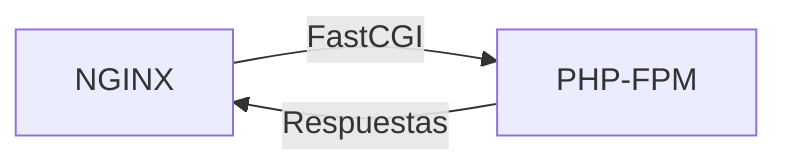
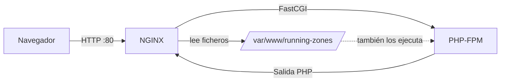

# Práctica 2.1: Despliegue de NGINX + PHP-FPM

## Objetivos

- Instalar y configurar NGINX + PHP-FPM en un servidor Ubuntu.
- Desplegar una aplicación PHP mediante `SFTP`.
- Configurar NGINX como proxy inverso para PHP-FPM.
- Gestionar virtual hosts y permisos de archivos.
- Verificar que la aplicación funciona correctamente.
- Diagnosticar y resolver problemas comunes del stack.

---

## Requisitos previos

- Un servidor (físico, virtual o en la nube) con Ubuntu 22.04 o 24.04 LTS y acceso por SSH.
- Usuario con privilegios de `sudo` en dicho servidor.
- Conexión SSH funcional desde tu máquina local al servidor.
- Aplicación PHP local en el directorio `running-zones/`.
- Configuración de NGINX local en `nginx/runningzones.conf`.

---

## Transferencia de archivos con SFTP

### ¿Para qué necesitamos SFTP en esta práctica?

En esta práctica necesitas **transferir ficheros desde tu máquina local al servidor remoto**. Específicamente:
- Los ficheros de tu aplicación PHP (`running-zones/`)
- El fichero de configuración de NGINX (`nginx/runningzones.conf`)

**SFTP (SSH File Transfer Protocol)** es el método estándar y seguro para transferir ficheros a servidores Linux. Funciona sobre la misma conexión SSH que ya estás usando para acceder al servidor, por lo que:
- **No requiere instalar software adicional** en el servidor
- **Todo el tráfico va cifrado** (ficheros, contraseñas, nombres de archivo)
- **Usa el mismo puerto 22** que SSH, facilitando la configuración de firewalls

!!! warning "SFTP no es FTP sobre SSH"
    A pesar de su nombre, SFTP **no tiene ninguna relación con FTP**. Es un protocolo completamente diferente que opera sobre SSH. Su nombre viene de "SSH File Transfer Protocol", pero su implementación es totalmente independiente del protocolo FTP tradicional.

### Comandos básicos de SFTP

Para conectarte al servidor desde tu máquina local:

```bash
sftp -i nginx-php-daw.pem ubuntu@<IP_SERVIDOR>
```

Una vez conectado, verás el prompt `sftp>`. Los comandos más importantes son:

| Comando | Descripción |
|---|---|
| `put archivo_local` | Sube un archivo **desde tu máquina local al servidor** |
| `put -r directorio_local/` | Sube un directorio completo de forma recursiva |
| `get archivo_remoto` | Descarga un archivo **desde el servidor a tu máquina local** |
| `ls` | Lista archivos en el directorio actual **del servidor** |
| `lls` | Lista archivos en el directorio actual **de tu máquina local** |
| `cd ruta` | Cambia al directorio **en el servidor** |
| `lcd ruta` | Cambia al directorio **en tu máquina local** (lcd = *local cd*) |
| `exit` | Cierra la sesión SFTP |

!!! info "¿De dónde a dónde?"
    Cuando usas `put`, estás subiendo ficheros **desde tu máquina local al servidor**. El comando `lcd` cambia el directorio en tu máquina local (origen), y `cd` cambia el directorio en el servidor (destino).

---

## Paso 1: Actualizar el sistema

Lo primero que hay que hacer **siempre** antes de instalar nada es actualizar los índices de paquetes y los propios paquetes del sistema. Esto garantiza que se instalan las últimas versiones disponibles y con sus parches de seguridad.

```bash
sudo apt update
sudo apt upgrade -y
```

- `apt update`: descarga los índices de paquetes desde los repositorios configurados. No instala nada, solo actualiza la lista de software disponible y sus versiones.
- `apt upgrade -y`: actualiza todos los paquetes instalados a sus últimas versiones. El flag `-y` responde afirmativamente a la confirmación.

!!! warning "Reinicio del sistema"
    Si se actualiza el kernel o ciertos paquetes del sistema, puede ser necesario reiniciar la máquina con `sudo reboot`.

---

## Paso 2: Instalar NGINX y PHP-FPM

### 2.1. ¿Qué es NGINX?

**NGINX** (pronunciado "engine-x") es un servidor web y proxy inverso de alto rendimiento desarrollado por Igor Sysoev en 2004. A diferencia de Apache (que usa un modelo basado en procesos/hilos), NGINX usa una **arquitectura orientada a eventos** que le permite manejar miles de conexiones concurrentes con muy bajo consumo de memoria.

**Funciones principales de NGINX:**
- Servir contenido estático (HTML, CSS, JavaScript, imágenes)
- Actuar como proxy inverso para aplicaciones dinámicas
- Balanceo de carga entre múltiples servidores
- Caché de respuestas
- Terminación SSL/TLS

### 2.2. ¿Qué es PHP-FPM y por qué existe?

**NGINX no puede ejecutar PHP directamente**. A diferencia de Apache con mod_php, NGINX necesita un procesador externo que interprete el código PHP y devuelva HTML.

#### ¿Qué es mod_php?

**mod_php** era el módulo tradicional de Apache para ejecutar PHP. PHP se integraba directamente dentro de Apache como un módulo más. Esto tenía problemas:
- Cada proceso de Apache cargaba PHP aunque solo sirviera imágenes o CSS
- Consumo de memoria muy alto
- Difícil de escalar en entornos compartidos

#### ¿Qué hace PHP-FPM?

**PHP-FPM (FastCGI Process Manager)** es un gestor de procesos PHP que mantiene un pool de workers (procesos PHP) listos para procesar peticiones. Funciona como un "servidor de aplicaciones PHP" independiente:


**Cómo funciona:**
1. NGINX recibe una petición para un archivo `.php`
2. NGINX envía la petición a PHP-FPM a través de un socket (Unix o TCP)
3. PHP-FPM asigna la petición a un worker PHP disponible
4. El worker ejecuta el código PHP y genera HTML
5. PHP-FPM devuelve el HTML a NGINX
6. NGINX envía la respuesta al cliente

**Ventajas sobre mod_php:**
- **Menos memoria**: Solo los workers PHP consumen RAM, no todo el servidor web
- **Mejor rendimiento**: NGINX sirve archivos estáticos (CSS, JS, imágenes) directamente sin pasar por PHP
- **Escalabilidad**: El pool de workers se ajusta dinámicamente según la carga
- **Aislamiento**: Cada sitio web puede tener su propio pool con configuración independiente

### 2.3. ¿Cómo se comunican NGINX y PHP-FPM?



**Dos modos de comunicación:**

1. **Socket Unix** (recomendado para mismo servidor):
   - Fichero especial en disco: `/run/php/php8.5-fpm.sock`
   - Más rápido que TCP (no hay overhead de red)
   - Solo funciona si NGINX y PHP-FPM están en la misma máquina
   - Permisos controlados via sistema de archivos

2. **Socket TCP** (para servidores separados):
   - Puerto de red: típicamente `9000` o `9001`
   - Permite separar NGINX y PHP-FPM en máquinas diferentes
   - Útil para arquitecturas escalables
   - Requiere configuración de firewall

### 2.4. Instalación de los paquetes

Instala NGINX, PHP 8.5 y las extensiones necesarias:

```bash
sudo apt install -y \
  nginx \
  php8.5 \
  php8.5-fpm \
  php-cli \
  php-mbstring \
  php-xml \
  php-curl
```

Descripción de cada paquete:

| Paquete | Función |
|---|---|
| `nginx` | El servidor web NGINX. |
| `php8.5` | Intérprete PHP 8.5 (meta-paquete). |
| `php8.5-fpm` | El gestor de procesos FastCGI para PHP 8.5. |
| `php-cli` | Intérprete PHP para usar desde la línea de comandos (`php -v`, scripts, artisan, composer...). |
| `php-mbstring` | Soporte para cadenas multibyte (UTF-8). Necesario para Laravel, Symfony y la mayoría de frameworks. |
| `php-xml` | Soporte para DOM, SimpleXML, XMLReader... Necesario para leer/generar ficheros XML. |
| `php-curl` | Permite a PHP realizar peticiones HTTP a otros servicios (APIs externas, pasarelas de pago...). |

### 2.5. Verificar que los servicios están activos

Tras la instalación, ambos servicios deberían haber arrancado automáticamente. Compruébalo:

```bash
sudo systemctl status nginx
sudo systemctl status php8.5-fpm
```

En la salida deberías ver `active (running)` en verde. Si no es así, arráncalos manualmente:

```bash
sudo systemctl start nginx
sudo systemctl start php8.5-fpm
```

!!! tip "Habilitar arranque automático"
    `systemctl enable nginx php8.5-fpm` hace que ambos servicios arranquen automáticamente al reiniciar el servidor.

---

## Paso 3: Copiar la aplicación al servidor

### 3.1. Transferencia desde la máquina local con `sftp`

Desde **tu terminal local** (no desde dentro del servidor), transfiere los archivos de tu aplicación usando `sftp`.

#### Opción A: Modo interactivo

Conecta al servidor con SFTP:

```bash
sftp -i nginx-php-daw.pem ubuntu@<IP_SERVIDOR>
```

Una vez dentro de la sesión SFTP, verás un prompt `sftp>`. Desde ahí ejecuta:

```sftp
mkdir /tmp/running-zones
cd /tmp/running-zones
lcd ruta/relativa/del/codigo
put -r *
exit
```

Explicación de cada comando:

| Comando | Significado |
|---|---|
| `mkdir /tmp/running-zones` | Crea el directorio temporal en el servidor. |
| `cd /tmp/running-zones` | Cambia al directorio remoto recién creado. |
| `lcd ruta/relativa/del/codigo` | Cambia al directorio **local** donde está la aplicación (`lcd` = *local change directory*). |
| `put -r *` | Sube todo el contenido del directorio local al directorio remoto de forma recursiva (`-r` = *recursive*). |
| `exit` | Cierra la sesión SFTP y vuelve a la terminal local. |

#### Opción B: Modo batch (automatizado)

Crea un fichero llamado `upload_app.txt` con los comandos:

```text title="upload_app.txt"
mkdir /tmp/running-zones
cd /tmp/running-zones
put -r ruta/relativa/del/codigo/*
exit
```

Y ejecútalo con el flag `-b`:

```bash
sftp -i nginx-php-daw.pem -b upload_app.txt ubuntu@<IP_SERVIDOR>
```

!!! tip "¿Por qué a `/tmp/` y no directamente a `/var/www/`?"
    Porque el usuario `ubuntu` no tiene permisos de escritura directos en `/var/www/` (es una ruta del sistema). Es más limpio subir los ficheros a `/tmp/` y luego, con `sudo`, moverlos al sitio definitivo.

!!! info "Diferencias entre SFTP y `rsync`"
    A diferencia de `rsync`, SFTP **no detecta ficheros modificados** ni los sincroniza de forma incremental: siempre sube todos los ficheros indicados. Sin embargo, tiene la ventaja de que **no requiere ningún software adicional** en el servidor, ya que el subsistema SFTP viene integrado en OpenSSH.

### 3.2. Mover los ficheros al directorio definitivo

Desde **dentro del servidor**, crea el directorio web y mueve los ficheros:

!!! info "Instalación de `rsync`"
    `rsync` no viene instalado por defecto en Ubuntu. Antes de continuar, instálalo con:
    ```bash
    sudo apt install rsync -y
    ```

```bash
sudo mkdir -p /var/www/running-zones
sudo rsync -av /tmp/running-zones/* /var/www/running-zones/
```

El flag `-p` en `mkdir` crea los directorios padres si no existen y no da error si el directorio ya existe.

### 3.3. Ajustar permisos y propietario

Esto es **crítico** para que NGINX (que corre como usuario `www-data`) pueda leer los ficheros:

```bash
sudo chown -R www-data:www-data /var/www/running-zones
sudo chmod -R 755 /var/www/running-zones
```

- `chown -R www-data:www-data`: cambia recursivamente el propietario y grupo de todos los ficheros al usuario `www-data`, que es el que usa NGINX y PHP-FPM en Debian/Ubuntu.
- `chmod -R 755`: establece permisos `rwxr-xr-x`:
    - **Propietario** (`www-data`): lectura, escritura y ejecución.
    - **Grupo** (`www-data`): lectura y ejecución.
    - **Otros**: lectura y ejecución.
- `755` es el permiso estándar para directorios web: todo el mundo puede leer, pero solo el propietario puede modificar.

!!! info "Directorios con escritura"
    Si tu aplicación necesita escribir en algún directorio (caché, subidas de usuarios, logs...), ese directorio concreto sí necesitaría permisos de escritura para `www-data` (`chmod 775` o similar).

---

## Paso 4: Instalar la configuración de NGINX

### 4.1. Transferir el fichero de configuración desde la máquina local

Desde **tu terminal local**, usa `sftp` para enviar el fichero al servidor:

```bash
sftp -i nginx-php-daw.pem ubuntu@<IP_SERVIDOR>
```

Una vez dentro de la sesión SFTP (`sftp>`):

```sftp
put nginx/runningzones.conf /tmp/runningzones.conf
exit
```

O en un solo comando usando el modo batch:

```bash
echo "put nginx/runningzones.conf /tmp/runningzones.conf" | sftp -i nginx-php-daw.pem ubuntu@<IP_SERVIDOR>
```

`put` transfiere el fichero local al directorio remoto especificado.

### 4.2. Colocar el fichero en `sites-available`

Desde **dentro del servidor**:

```bash
sudo cp /tmp/runningzones.conf /etc/nginx/sites-available/runningzones
```

NGINX en Debian/Ubuntu usa una convención muy cómoda para gestionar los sitios web (virtual hosts):

| Directorio | Propósito |
|---|---|
| `/etc/nginx/sites-available/` | Aquí se guardan **todos** los ficheros de configuración de sitios, estén activos o no. |
| `/etc/nginx/sites-enabled/` | Aquí solo hay **enlaces simbólicos** a los ficheros de `sites-available/` que están activos. |

Esta separación permite activar/desactivar sitios simplemente creando o borrando enlaces, sin tocar los ficheros originales.

### 4.3. Contenido del fichero `runningzones.conf`

!!! example "Configuración de ejemplo"
    Si no tienes el fichero aún, este es un ejemplo completo:

    ```nginx title="nginx/runningzones.conf"
    server {
        listen 80;
        server_name _;

        root /var/www/running-zones;
        index index.php index.html;

        location / {
            try_files $uri $uri/ =404;
        }

        location ~ \.php$ {
            include snippets/fastcgi-php.conf;
            fastcgi_pass unix:/run/php/php8.5-fpm.sock;
        }

        location ~ /\.ht {
            deny all;
        }
    }
    ```

Explicación directiva por directiva:

| Directiva | Significado |
|---|---|
| `listen 80` | Este *server block* escucha en el puerto 80 (HTTP). |
| `server_name _` | El guion bajo es un *catch-all*: este bloque responde a cualquier nombre de dominio que llegue al servidor. En producción aquí pondrías tu dominio real (ej: `runningzones.daw`). |
| `root /var/www/running-zones` | Directorio raíz de donde NGINX buscará los ficheros. |
| `index index.php index.html` | Cuando un cliente pide un directorio (ej: `/`), NGINX buscará primero `index.php` y si no existe, `index.html`. |
| `location /` | Bloque que se aplica a todas las URLs. |
| `try_files $uri $uri/ =404` | Para cada petición, prueba primero si existe el fichero exacto (`$uri`), luego si existe como directorio (`$uri/`), y si no, devuelve un 404. |
| `location ~ \.php$` | Bloque que se aplica a cualquier URL que termine en `.php`. La `~` indica que es una expresión regular. |
| `include snippets/fastcgi-php.conf` | Incluye un fichero de configuración estándar de Ubuntu que establece los parámetros FastCGI básicos. |
| `fastcgi_pass unix:/run/php/php8.5-fpm.sock` | **Esta es la línea clave**: le dice a NGINX que pase las peticiones PHP al socket Unix de PHP-FPM. NGINX no ejecuta PHP él mismo, simplemente *reenvía* la petición al proceso FPM a través de ese socket. |
| `location ~ /\.ht` | Bloquea el acceso a ficheros `.htaccess` y `.htpasswd` (herencia de Apache), devolviendo un `deny all`. |

### 4.4. Activar el sitio

Crea un enlace simbólico desde `sites-available` a `sites-enabled`:

```bash
sudo ln -s \
  /etc/nginx/sites-available/runningzones \
  /etc/nginx/sites-enabled/
```

El comando `ln -s` crea un enlace simbólico (un *acceso directo*). NGINX, al arrancar, lee todo lo que haya en `sites-enabled/`.

### 4.5. Eliminar el sitio por defecto

Para evitar conflictos con el `server_name _` de la configuración por defecto:

```bash
sudo rm -f /etc/nginx/sites-enabled/default
```

No borres el fichero de `sites-available/default`, solo el enlace de `sites-enabled/`. Así podrás reactivarlo si lo necesitas.

### 4.6. Verificar la sintaxis

**Este paso es obligatorio** antes de reiniciar. NGINX puede validar su propia configuración:

```bash
sudo nginx -t
```

Salida esperada:

```
nginx: the configuration file /etc/nginx/nginx.conf syntax is ok
nginx: configuration file /etc/nginx/nginx.conf test is successful
```

!!! danger "Nunca reinicies NGINX sin hacer `nginx -t` primero"
    Si la configuración tiene un error y reinicias, NGINX no arrancará y tu web dejará de funcionar. Con el test previo, si hay un error, NGINX sigue corriendo con la configuración anterior.

---

## Paso 5: Asegurar que el firewall permite el tráfico HTTP

El servidor debe tener los puertos necesarios abiertos en cualquier firewall que haya (firewall del sistema operativo, Security Groups del proveedor cloud, reglas de red de la VPC, etc.).

Los puertos que deben estar abiertos son:

| Servicio | Puerto | Protocolo |
|---|---|---|
| SSH | 22 | TCP |
| HTTP | 80 | TCP |
| HTTPS | 443 | TCP |

!!! warning "Firewalls en la nube"
    Si tu servidor está en AWS EC2, recuerda que además del firewall interno del sistema, debes configurar los **Security Groups** en la consola de AWS para permitir el tráfico en los puertos indicados. Consulta la documentación de AWS o los apuntes de configuración de EC2.

---

## Paso 6: Reiniciar servicios y verificar

### 6.1. Reiniciar los servicios

Reinicia ambos servicios para aplicar la nueva configuración:

```bash
sudo systemctl restart nginx
sudo systemctl restart php8.5-fpm
```

Alternativamente, puedes usar `reload` en lugar de `restart`. La diferencia:

| Opción | Comportamiento |
|---|---|
| `restart` | Para y vuelve a arrancar el servicio (breve corte de servicio). |
| `reload` | Recarga la configuración sin cortar las conexiones activas (solo disponible si el servicio lo soporta; NGINX sí lo soporta). |

Para NGINX es preferible usar `reload`:

```bash
sudo systemctl reload nginx
```

### 6.2. Verificar que NGINX responde

Desde **dentro del servidor**, comprueba que NGINX sirve contenido:

```bash
curl -s -o /dev/null -w "%{http_code}" http://localhost
```

- `curl`: herramienta de línea de comandos para hacer peticiones HTTP.
- `-s`: modo silencioso (no muestra la barra de progreso).
- `-o /dev/null`: descarta el cuerpo de la respuesta.
- `-w "%{http_code}"`: muestra solo el código HTTP de estado.

Debe devolver `200`.

### 6.3. Verificar que PHP se ejecuta correctamente

La prueba más importante: comprueba que un fichero `.php` se **ejecuta** y no se **descarga como texto plano**:

```bash
curl -s http://localhost/index.php | head -20
```

- Si ves **HTML renderizado** → PHP-FPM funciona correctamente.
- Si ves **código PHP crudo** (`<?php ...`) → NGINX no está pasando las peticiones a PHP-FPM. Revisa la directiva `fastcgi_pass`.
- Si ves **502 Bad Gateway** → PHP-FPM no está corriendo o el socket no existe.

### 6.4. Comprobar qué sockets de PHP-FPM existen

Si tienes dudas sobre si el socket existe, puedes listarlo:

```bash
ls -la /run/php/
```

Deberías ver algo como:

```
srw-rw---- 1 www-data www-data 0 ... php8.5-fpm.sock
```

La `s` al principio indica que es un socket Unix.

---

## Paso 7: Verificación final en el navegador

Abre un navegador y accede a:

```
http://<IP_SERVIDOR>/
```

Deberías ver tu aplicación **Running Zones** funcionando correctamente.

### 7.1. Verificación completa con curl

Para hacer pruebas más exhaustivas sin necesidad de un navegador, puedes usar `curl` con diferentes opciones:

**Probar que el sitio responde correctamente:**

```bash
# Ver código de estado HTTP
curl -I http://localhost

# Ver headers completos de la respuesta
curl -v http://localhost

# Descargar y mostrar solo las primeras líneas
curl -s http://localhost/index.php | head -30
```

**Probar con un nombre de dominio específico:**

Si tu configuración de NGINX usa `server_name runningzones.daw`, necesitas indicar a curl que use ese nombre de dominio, aunque accedas por IP:

```bash
# Usando el header Host
curl -H "Host: runningzones.daw" http://<IP_SERVIDOR>/

# Usando --resolve (recomendado)
curl --resolve runningzones.daw:80:<IP_SERVIDOR> http://runningzones.daw/
```

!!! info "¿Por qué usar `--resolve`?"
    La opción `--resolve` le dice a curl que resuelva el dominio `runningzones.daw` a la IP especificada, sin necesidad de modificar `/etc/hosts`. Es útil para probar virtual hosts sin alterar la configuración DNS del sistema.

### 7.2. Verificación desde un contenedor Docker

En entornos donde **no tienes acceso a `/etc/hosts`** del sistema host (por ejemplo, en ordenadores corporativos con restricciones, o cuando trabajas en equipos compartidos), puedes usar un contenedor Docker para hacer las pruebas.

**Opción 1: Usar `--resolve` dentro del contenedor**

```bash
docker run --rm curlimages/curl \
  --resolve runningzones.daw:80:<IP_SERVIDOR> \
  http://runningzones.daw/
```

**Opción 2: Usar `--add-host` en el contenedor**

Docker permite inyectar entradas DNS en el contenedor sin modificar el `/etc/hosts` del host:

```bash
docker run --rm \
  --add-host runningzones.daw:<IP_SERVIDOR> \
  curlimages/curl \
  http://runningzones.daw/
```

!!! tip "Ventajas de usar Docker para pruebas"
    - **No requiere permisos administrativos** en el host
    - **Aislamiento completo**: no modificas la configuración del sistema
    - **Reproducible**: el mismo comando funciona en cualquier máquina con Docker
    - **Portátil**: útil para compartir scripts de testing con compañeros

**Verificar múltiples aspectos desde Docker:**

```bash
# Crear un alias para simplificar
alias test-runningzones='docker run --rm --add-host runningzones.daw:<IP_SERVIDOR> curlimages/curl'

# Probar código de estado
test-runningzones -I http://runningzones.daw/

# Probar que PHP se ejecuta
test-runningzones -s http://runningzones.daw/index.php | head -20

# Probar un recurso estático
test-runningzones -I http://runningzones.daw/css/style.css
```

!!! warning "Acceso a la red del contenedor"
    Si el servidor NGINX está en tu máquina local y usas Docker Desktop (macOS/Windows), usa `host.docker.internal` en lugar de `localhost` o `<IP_SERVIDOR>`:
    ```bash
    docker run --rm \
      --add-host runningzones.daw:host.docker.internal \
      curlimages/curl \
      http://runningzones.daw/
    ```

---

## Paso 8: Diagnóstico y resolución de problemas

Cuando algo falla, los **logs** son tu mejor aliado. Aquí tienes una tabla de síntomas, causas y soluciones:

| Problema | Causa probable | Cómo diagnosticarlo | Solución |
|---|---|---|---|
| **502 Bad Gateway** | PHP-FPM no corre o el socket no coincide | `sudo systemctl status php8.5-fpm` | `sudo systemctl start php8.5-fpm`. Revisa que `fastcgi_pass` apunte al socket correcto. |
| **Se descargan los .php** | Falta o está mal el bloque `location ~ \.php$` | `curl http://localhost/index.php` | Revisa `runningzones.conf` y la directiva `fastcgi_pass`. |
| **403 Forbidden** | Permisos incorrectos en el directorio | `ls -la /var/www/running-zones/` | `sudo chown -R www-data:www-data /var/www/running-zones` y `sudo chmod -R 755 /var/www/running-zones`. |
| **404 Not Found** | `root` apunta a un directorio incorrecto o no existe `index.php` | `ls /var/www/running-zones/` | Verifica la directiva `root` en la config de NGINX. |
| **500 Internal Server Error** | Error en el código PHP | Logs de NGINX y de PHP-FPM | Revisa los logs (ver abajo). |
| **No conecta desde fuera** | Firewall no abre el puerto 80 | Revisar reglas del firewall | Abre el puerto correspondiente. |
| **413 Request Entity Too Large** | Límite de tamaño de subida de PHP | – | Edita `/etc/php/8.5/fpm/php.ini` y aumenta `upload_max_filesize` y `post_max_size`. |

### Comandos para revisar logs

```bash title="Diagnóstico en tiempo real"
# Logs de errores de NGINX (en tiempo real)
sudo tail -f /var/log/nginx/error.log

# Logs de acceso de NGINX (quién visita tu web)
sudo tail -f /var/log/nginx/access.log

# Logs de PHP-FPM (errores de la aplicación PHP)
sudo journalctl -u php8.5-fpm -n 50 --no-pager

# Log específico de PHP-FPM si está configurado
sudo tail -f /var/log/php8.5-fpm.log
```

!!! tip "Truco para depurar"
    Abre varios paneles de terminal y deja un `tail -f` en cada uno mientras haces pruebas en el navegador. Así verás los errores en tiempo real.

---

## Arquitectura del conjunto

Para que quede claro cómo encajan las piezas:



1. El cliente pide `http://servidor/index.php`.
2. **NGINX** recibe la petición, ve que termina en `.php`, y la pasa por el socket FastCGI a **PHP-FPM**.
3. **PHP-FPM** ejecuta `index.php` en uno de sus procesos worker y genera HTML.
4. **NGINX** recibe ese HTML y se lo devuelve al cliente.

Para ficheros estáticos (CSS, JS, imágenes), NGINX los sirve directamente sin pasar por PHP-FPM, lo que lo hace muy eficiente.

---

## Propuesta: Despliegue con PHP-FPM en una máquina distinta

Como extensión de esta práctica, realiza el mismo despliegue pero con **NGINX y PHP-FPM en máquinas separadas**.

### Configuración básica

**En la máquina con PHP-FPM:**

Edita `/etc/php/8.5/fpm/pool.d/www.conf` y cambia el socket Unix por TCP:

```ini
listen = 0.0.0.0:9000
```

Reinicia PHP-FPM:

```bash
sudo systemctl restart php8.5-fpm
```

**En la máquina con NGINX:**

Modifica la configuración del virtual host para apuntar a la IP de la máquina con PHP-FPM.


Recarga NGINX:

```bash
sudo systemctl reload nginx
```

**Consideraciones adicionales:**

- Sube los ficheros de la aplicación a la máquina con PHP-FPM usando SFTP.
- Abre el puerto 9000 en el firewall de la máquina con PHP-FPM (solo desde el SG de la máqina de NGINX).
- Verifica con `curl` que la aplicación funciona correctamente.

