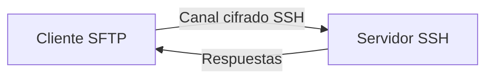
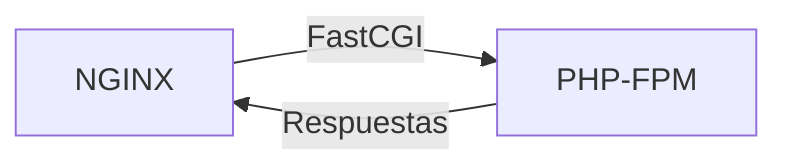
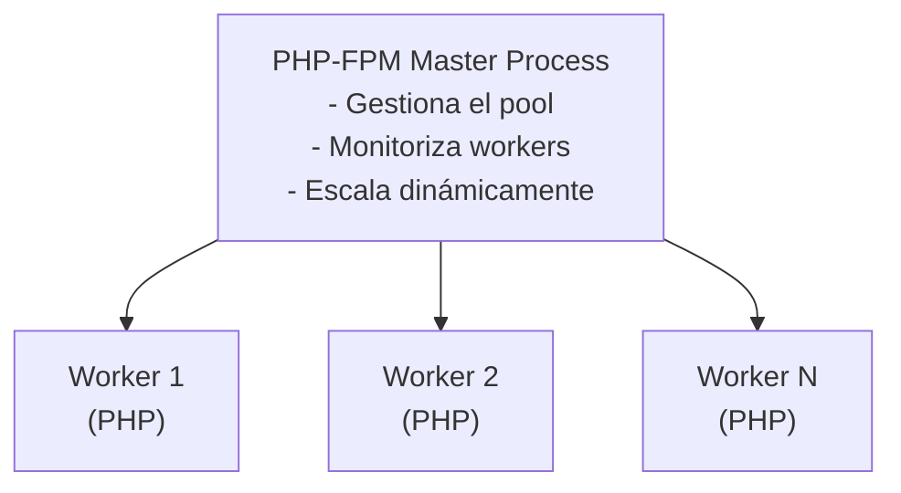
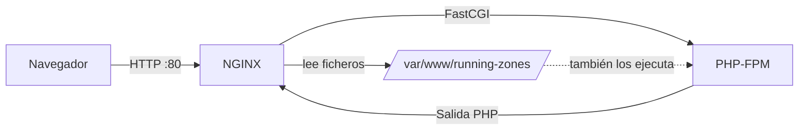

# Práctica 2.1: Despliegue de NGINX + PHP-FPM

## Objetivos

- Instalar y configurar NGINX + PHP-FPM en un servidor Ubuntu.
- Desplegar una aplicación PHP mediante `SFTP`.
- Configurar NGINX como proxy inverso para PHP-FPM.
- Gestionar virtual hosts y permisos de archivos.
- Verificar que la aplicación funciona correctamente.
- Diagnosticar y resolver problemas comunes del stack.

---

## Requisitos previos

- Un servidor (físico, virtual o en la nube) con Ubuntu 22.04 o 24.04 LTS y acceso por SSH.
- Usuario con privilegios de `sudo` en dicho servidor.
- Conexión SSH funcional desde tu máquina local al servidor.
- Aplicación PHP local en el directorio `running-zones/`.
- Configuración de NGINX local en `nginx/runningzones.conf`.

---

## Transferencia de archivos con SFTP

### Origen e historia de SFTP

SFTP (**SSH File Transfer Protocol**) fue desarrollado por Tatu Ylonen (creador de SSH) como parte del proyecto SSH2. La primera especificación formal fue publicada como borrador de IETF en 2006 (draft-ietf-secsh-filexfer), aunque su uso comenzó años antes como parte integral de SSH-2.

!!! warning "SFTP no es FTP sobre SSH"
    A pesar de lo que sugiere su nombre, SFTP **no tiene ninguna relación con FTP** (File Transfer Protocol). Es un protocolo completamente nuevo y diferente que fue diseñado desde cero para operar sobre el canal cifrado de SSH. El nombre "SSH File Transfer Protocol" se eligió porque su *función* es transferir archivos, pero su implementación, comandos y funcionamiento interno no comparten nada con FTP.

### ¿Qué es SFTP?

SFTP es un protocolo de transferencia de archivos que opera como un **subsistema** dentro de una sesión SSH. Esto significa que:

1. **Usa la misma conexión que SSH**: No abre puertos adicionales. Si puedes hacer SSH a un servidor (puerto 22), puedes hacer SFTP.
2. **Hereda la seguridad de SSH**: Todo el tráfico (comandos, datos, metadatos, nombres de archivo) viaja cifrado dentro del túnel SSH.
3. **Usa la misma autenticación**: Las mismas claves públicas/privadas o contraseñas que usas para SSH sirven para SFTP.
4. **Es un protocolo independiente**: Tiene su propia especificación, comandos y semántica, completamente separados de FTP.

!!! info "No necesitas instalar nada en el servidor"
    A diferencia de FTP tradicional (que requiere instalar servidores como vsftpd, proftpd, etc.), **SFTP no necesita software adicional**. El subsistema SFTP viene incluido en **OpenSSH Server** (`openssh-server`), que ya está instalado por defecto en Ubuntu y en la mayoría de distribuciones Linux. Solo necesitas asegurarte de que el servicio SSH esté activo (`sudo systemctl status ssh`).

### Arquitectura del protocolo SFTP

SFTP sigue un modelo cliente-servidor donde:



El protocolo funciona mediante un sistema de **peticiones y respuestas**:

1. El cliente envía una **petición** (ej: "abrir archivo", "leer datos", "cerrar archivo")
2. El servidor procesa la petición y devuelve una **respuesta** (ej: "handle del archivo", "datos", "OK")
3. Cada operación es atómica y está identificada con un ID para mantener el orden

### Cómo se establece una conexión SFTP (paso a paso)

Cuando ejecutas `sftp usuario@servidor`, ocurre lo siguiente:

1. **Handshake SSH**: El cliente y el servidor negocian la versión del protocolo SSH y los algoritmos de cifrado a usar.
2. **Autenticación**: El servidor verifica la identidad del cliente (clave pública, contraseña, certificado).
3. **Apertura de canal**: Se establece un canal de sesión dentro de la conexión SSH.
4. **Activación del subsistema**: El cliente solicita activar el subsistema SFTP (`subsystem sftp`).
5. **Intercambio de versiones SFTP**: Cliente y servidor intercambian las versiones del protocolo SFTP que soportan.
6. **Listo para transferir**: A partir de aquí, el cliente puede enviar peticiones SFTP (abrir, leer, escribir, cerrar archivos, listar directorios, etc.).

### Diferencias técnicas entre SFTP, FTP y FTPS

| Característica | SFTP | FTP | FTPS |
|---|---|---|---|
| **Puerto** | 22 (SSH) | 21 (control) + puertos dinámicos (datos) | 21 (control) + puertos dinámicos (datos) |
| **Canales** | 1 canal (todo mezclado) | 2 canales separados (control + datos) | 2 canales separados (control + datos) |
| **Cifrado** | Todo cifrado (comandos + datos) | Ninguno (texto plano) | Cifrado opcional (TLS/SSL) |
| **Firewall** | Fácil (solo puerto 22) | Difícil (puertos dinámicos) | Difícil (puertos dinámicos) |
| **Autenticación** | SSH (claves, contraseñas, certificados) | Usuario/contraseña (texto plano) | Usuario/contraseña + certificados TLS |
| **Integridad** | HMAC (detección de manipulación) | Ninguna | TLS (si se usa) |
| **Rendimiento** | Alto (un solo canal) | Medio (overhead de dos canales) | Medio (overhead de TLS + dos canales) |
| **Resumen de conexión** | Sí (reanuda transfers) | No | Parcial |

!!! info "¿Por qué SFTP es más fácil para firewalls?"
    FTP y FTPS requieren abrir múltiples puertos dinámicos para las conexiones de datos, lo que complica la configuración de firewalls y NAT. SFTP usa un único puerto (22) para todo, haciendo que sea mucho más sencillo de configurar en entornos corporativos o cloud.

### Seguridad en SFTP

SFTP hereda todas las características de seguridad de SSH:

- **Cifrado de extremo a extremo**: Todo el tráfico está cifrado, incluyendo los nombres de archivo y directorio.
- **Autenticación fuerte**: Soporta claves públicas RSA/Ed25519, certificados SSH y contraseñas.
- **Integridad de datos**: Usa HMAC (Hash-based Message Authentication Code) para detectar cualquier manipulación de los datos en tránsito.
- **Protección contra replay**: Los paquetes tienen números de secuencia para evitar ataques de repetición.
- **Forward secrecy**: Si se usan algoritmos modernos (como Curve25519), incluso si la clave del servidor se compromete en el futuro, las sesiones pasadas no pueden ser descifradas.

### Comandos básicos de SFTP

SFTP proporciona una interfaz interactiva similar a FTP, pero segura:

| Comando | Descripción | Ejemplo |
|---|---|---|
| `sftp usuario@servidor` | Conectar al servidor | `sftp ubuntu@192.168.1.100` |
| `put archivo` | Subir un archivo | `put index.php` |
| `put -r directorio/` | Subir directorio recursivamente | `put -r running-zones/` |
| `get archivo` | Descargar un archivo | `get index.php` |
| `get -r directorio/` | Descargar directorio recursivamente | `get -r backup/` |
| `ls` | Listar archivos en directorio remoto | `ls` |
| `lls` | Listar archivos en directorio local | `lls` |
| `cd ruta` | Cambiar directorio remoto | `cd /var/www` |
| `lcd ruta` | Cambiar directorio local | `lcd ~/proyectos` |
| `mkdir nombre` | Crear directorio remoto | `mkdir backups` |
| `rm archivo` | Eliminar archivo remoto | `rm old.php` |
| `chmod modo archivo` | Cambiar permisos | `chmod 755 script.sh` |
| `chown uid archivo` | Cambiar propietario | `chown 1000 file.txt` |
| `exit` o `quit` | Salir de SFTP | `exit` |

### SFTP con clave SSH

Para usar SFTP con una clave SSH privada:

```bash
sftp -i nginx-php-daw.pem ubuntu@<IP_SERVIDOR>
```

### Modo batch (automatizado)

Para automatizar transferencias sin interacción, usa el modo batch con el flag `-b`:

```bash
sftp -i nginx-php-daw.pem -b batch_sftp.txt ubuntu@<IP_SERVIDOR>
```

Donde `batch_sftp.txt` contiene los comandos:

```text
cd /tmp
mkdir running-zones
cd running-zones
put -r /ruta/local/running-zones/*
exit
```

!!! tip "SFTP es el estándar actual"
    SFTP ha reemplazado completamente a FTP y FTPS en entornos profesionales. Todos los servidores SSH modernos (OpenSSH, Dropbear) lo incluyen por defecto. Es el método recomendado para transferencia segura de archivos en Linux/Unix.

---

## Paso 1: Actualizar el sistema

Lo primero que hay que hacer **siempre** antes de instalar nada es actualizar los índices de paquetes y los propios paquetes del sistema. Esto garantiza que se instalan las últimas versiones disponibles y con sus parches de seguridad.

```bash
sudo apt update
sudo apt upgrade -y
```

- `apt update`: descarga los índices de paquetes desde los repositorios configurados. No instala nada, solo actualiza la lista de software disponible y sus versiones.
- `apt upgrade -y`: actualiza todos los paquetes instalados a sus últimas versiones. El flag `-y` responde afirmativamente a la confirmación.

!!! warning "Reinicio del sistema"
    Si se actualiza el kernel o ciertos paquetes del sistema, puede ser necesario reiniciar la máquina con `sudo reboot`.

---

## Paso 2: Instalar NGINX y PHP-FPM

### 2.1. ¿Qué es NGINX?

**NGINX** (pronunciado "engine-x") es un servidor web y proxy inverso de alto rendimiento desarrollado por Igor Sysoev en 2004. A diferencia de Apache (que usa un modelo basado en procesos/hilos), NGINX usa una **arquitectura orientada a eventos** que le permite manejar miles de conexiones concurrentes con muy bajo consumo de memoria.

**Funciones principales de NGINX:**
- Servir contenido estático (HTML, CSS, JavaScript, imágenes)
- Actuar como proxy inverso para aplicaciones dinámicas
- Balanceo de carga entre múltiples servidores
- Caché de respuestas
- Terminación SSL/TLS

### 2.2. ¿Qué es PHP-FPM y por qué existe?

Para entender PHP-FPM, necesitamos repasar la historia de cómo PHP se ha integrado con servidores web:

#### Evolución histórica

1. **CGI (Common Gateway Interface) - años 90**: 

    + Cada petición HTTP lanzaba un nuevo proceso PHP desde cero

    + Extremadamente lento: overhead de iniciar el intérprete PHP en cada petición
    
    + Consumo excesivo de CPU y memoria

2. **mod_php (Apache) - principios 2000**:
     
    + PHP se integraba como módulo dentro de Apache
    + Más rápido que CGI, pero...
    + Cada proceso de Apache cargaba PHP aunque sirviera archivos estáticos
    + Consumo de memoria muy alto (cada worker de Apache tenía PHP cargado)
    + Difícil de configurar para entornos compartidos (hosting)

3. **FastCGI - mediados 2000**:

    + PHP se ejecuta como proceso separado del servidor web
    + El servidor web (Apache, NGINX) envía peticiones a PHP vía protocolo FastCGI
    + PHP mantiene procesos ya iniciados esperando peticiones
    + Más eficiente, pero la gestión de procesos era manual y compleja

4. **PHP-FPM (FastCGI Process Manager) - 2008**:

    + Solución integrada para gestionar procesos FastCGI
    + Gestiona automáticamente el ciclo de vida de los procesos PHP
    + Pool de procesos con escalado dinámico
    + Métricas y monitorización integradas
    + Se convirtió en el estándar para PHP con NGINX

#### ¿Qué es exactamente PHP-FPM?

**PHP-FPM (FastCGI Process Manager)** es un gestor de procesos que mantiene un **pool** de workers PHP listos para procesar peticiones. Funciona como un "servidor de aplicaciones PHP" que:

- Inicia y mantiene un conjunto de procesos PHP en memoria
- Recibe peticiones de NGINX a través de un socket (Unix o TCP)
- Asigna cada petición a un worker disponible
- Gestiona el ciclo de vida de los workers (inicio, reciclaje, terminación)
- Escala dinámicamente según la carga

### 2.3. ¿Cómo se comunican NGINX y PHP-FPM?



**Dos modos de comunicación:**

1. **Socket Unix** (recomendado para mismo servidor):
   - Fichero especial en disco: `/run/php/php8.3-fpm.sock`
   - Más rápido que TCP (no hay overhead de red)
   - Solo funciona si NGINX y PHP-FPM están en la misma máquina
   - Permisos controlados via sistema de archivos

2. **Socket TCP** (para servidores separados):
   - Puerto de red: típicamente `9000` o `9001`
   - Permite separar NGINX y PHP-FPM en máquinas diferentes
   - Útil para arquitecturas escalables
   - Requiere configuración de firewall

### 2.4. Arquitectura del pool de procesos

PHP-FPM gestiona un **pool** de workers (procesos hijos) que ejecutan el código PHP:



**Parámetros clave del pool** (en `/etc/php/8.3/fpm/pool.d/www.conf`):

| Parámetro | Descripción | Valor típico |
|---|---|---|
| `pm` | Modo de gestión de procesos | `dynamic` |
| `pm.max_children` | Máximo número de workers simultáneos | 5-50 (según RAM) |
| `pm.start_servers` | Workers iniciados al arrancar | 2-5 |
| `pm.min_spare_servers` | Mínimo de workers idle | 1-2 |
| `pm.max_spare_servers` | Máximo de workers idle | 3-5 |
| `pm.max_requests` | Peticiones antes de reciclar worker | 500-1000 |

!!! info "¿Cuántos workers necesitas?"
    Una regla general: cada worker PHP consume 20-50 MB de RAM. Si tu servidor tiene 1 GB de RAM y necesitas reservar 500 MB para el sistema, puedes tener aproximadamente `pm.max_children = 10-15`. Monitoriza el uso de memoria con `top` o `htop`.

### 2.5. Ventajas de PHP-FPM sobre mod_php

| Característica | mod_php (Apache) | PHP-FPM (NGINX) |
|---|---|---|
| **Consumo de memoria** | Alto (PHP cargado en cada worker) | Bajo (solo workers PHP cuando se necesitan) |
| **Rendimiento estáticos** | Bajo (pasa por PHP incluso para estáticos) | Alto (NGINX sirve estáticos directamente) |
| **Escalabilidad** | Limitada | Alta (pool dinámico) |
| **Aislamiento** | Difícil (todos comparten mismo PHP) | Fácil (pools separados por sitio) |
| **Recarga de configuración** | Requiere reiniciar Apache | `reload` sin cortar conexiones |
| **Entornos compartidos** | Problemático | Ideal (cada sitio con su pool) |

### 2.6. Instalación de los paquetes

Instala NGINX, PHP 8.3 y las extensiones necesarias:

```bash
sudo apt install -y \
  nginx \
  php8.3 \
  php8.3-fpm \
  php-cli \
  php-mbstring \
  php-xml \
  php-curl
```

Descripción de cada paquete:

| Paquete | Función |
|---|---|
| `nginx` | El servidor web NGINX. |
| `php8.3` | Intérprete PHP 8.3 (meta-paquete). |
| `php8.3-fpm` | El gestor de procesos FastCGI para PHP 8.3. |
| `php-cli` | Intérprete PHP para usar desde la línea de comandos (`php -v`, scripts, artisan, composer...). |
| `php-mbstring` | Soporte para cadenas multibyte (UTF-8). Necesario para Laravel, Symfony y la mayoría de frameworks. |
| `php-xml` | Soporte para DOM, SimpleXML, XMLReader... Necesario para leer/generar ficheros XML. |
| `php-curl` | Permite a PHP realizar peticiones HTTP a otros servicios (APIs externas, pasarelas de pago...). |

### 2.3. Verificar que los servicios están activos

Tras la instalación, ambos servicios deberían haber arrancado automáticamente. Compruébalo:

```bash
sudo systemctl status nginx
sudo systemctl status php8.3-fpm
```

En la salida deberías ver `active (running)` en verde. Si no es así, arráncalos manualmente:

```bash
sudo systemctl start nginx
sudo systemctl start php8.3-fpm
```

!!! tip "Habilitar arranque automático"
    `systemctl enable nginx php8.3-fpm` hace que ambos servicios arranquen automáticamente al reiniciar el servidor.

---

## Paso 3: Copiar la aplicación al servidor

### 3.1. Transferencia desde la máquina local con `sftp`

Desde **tu terminal local** (no desde dentro del servidor), transfiere los archivos de tu aplicación usando `sftp`.

#### Opción A: Modo interactivo

Conecta al servidor con SFTP:

```bash
sftp -i nginx-php-daw.pem ubuntu@<IP_SERVIDOR>
```

Una vez dentro de la sesión SFTP, verás un prompt `sftp>`. Desde ahí ejecuta:

```sftp
mkdir /tmp/running-zones
cd /tmp/running-zones
lcd running-zones
put -r *
exit
```

Explicación de cada comando:

| Comando | Significado |
|---|---|
| `mkdir /tmp/running-zones` | Crea el directorio temporal en el servidor. |
| `cd /tmp/running-zones` | Cambia al directorio remoto recién creado. |
| `lcd running-zones` | Cambia al directorio **local** donde está la aplicación (`lcd` = *local change directory*). |
| `put -r *` | Sube todo el contenido del directorio local al directorio remoto de forma recursiva (`-r` = *recursive*). |
| `exit` | Cierra la sesión SFTP y vuelve a la terminal local. |

#### Opción B: Modo batch (automatizado)

Crea un fichero llamado `upload_app.txt` con los comandos:

```text title="upload_app.txt"
mkdir /tmp/running-zones
cd /tmp/running-zones
put -r running-zones/*
exit
```

Y ejecútalo con el flag `-b`:

```bash
sftp -i nginx-php-daw.pem -b upload_app.txt ubuntu@<IP_SERVIDOR>
```

!!! tip "¿Por qué a `/tmp/` y no directamente a `/var/www/`?"
    Porque el usuario `ubuntu` no tiene permisos de escritura directos en `/var/www/` (es una ruta del sistema). Es más limpio subir los ficheros a `/tmp/` y luego, con `sudo`, moverlos al sitio definitivo.

!!! info "Diferencias entre SFTP y `rsync`"
    A diferencia de `rsync`, SFTP **no detecta ficheros modificados** ni los sincroniza de forma incremental: siempre sube todos los ficheros indicados. Sin embargo, tiene la ventaja de que **no requiere ningún software adicional** en el servidor, ya que el subsistema SFTP viene integrado en OpenSSH.

### 3.2. Mover los ficheros al directorio definitivo

Desde **dentro del servidor**, crea el directorio web y mueve los ficheros:

!!! info "Instalación de `rsync`"
    `rsync` no viene instalado por defecto en Ubuntu. Antes de continuar, instálalo con:
    ```bash
    sudo apt install rsync -y
    ```

```bash
sudo mkdir -p /var/www/running-zones
sudo rsync -av /tmp/running-zones/ /var/www/running-zones/
```

El flag `-p` en `mkdir` crea los directorios padres si no existen y no da error si el directorio ya existe.

### 3.3. Ajustar permisos y propietario

Esto es **crítico** para que NGINX (que corre como usuario `www-data`) pueda leer los ficheros:

```bash
sudo chown -R www-data:www-data /var/www/running-zones
sudo chmod -R 755 /var/www/running-zones
```

- `chown -R www-data:www-data`: cambia recursivamente el propietario y grupo de todos los ficheros al usuario `www-data`, que es el que usa NGINX y PHP-FPM en Debian/Ubuntu.
- `chmod -R 755`: establece permisos `rwxr-xr-x`:
    - **Propietario** (`www-data`): lectura, escritura y ejecución.
    - **Grupo** (`www-data`): lectura y ejecución.
    - **Otros**: lectura y ejecución.
- `755` es el permiso estándar para directorios web: todo el mundo puede leer, pero solo el propietario puede modificar.

!!! info "Directorios con escritura"
    Si tu aplicación necesita escribir en algún directorio (caché, subidas de usuarios, logs...), ese directorio concreto sí necesitaría permisos de escritura para `www-data` (`chmod 775` o similar).

---

## Paso 4: Instalar la configuración de NGINX

### 4.1. Transferir el fichero de configuración desde la máquina local

Desde **tu terminal local**, usa `sftp` para enviar el fichero al servidor:

```bash
sftp -i nginx-php-daw.pem ubuntu@<IP_SERVIDOR>
```

Una vez dentro de la sesión SFTP (`sftp>`):

```sftp
put nginx/runningzones.conf /tmp/runningzones.conf
exit
```

O en un solo comando usando el modo batch:

```bash
echo "put nginx/runningzones.conf /tmp/runningzones.conf" | sftp -i nginx-php-daw.pem ubuntu@<IP_SERVIDOR>
```

`put` transfiere el fichero local al directorio remoto especificado.

### 4.2. Colocar el fichero en `sites-available`

Desde **dentro del servidor**:

```bash
sudo cp /tmp/runningzones.conf /etc/nginx/sites-available/runningzones
```

NGINX en Debian/Ubuntu usa una convención muy cómoda para gestionar los sitios web (virtual hosts):

| Directorio | Propósito |
|---|---|
| `/etc/nginx/sites-available/` | Aquí se guardan **todos** los ficheros de configuración de sitios, estén activos o no. |
| `/etc/nginx/sites-enabled/` | Aquí solo hay **enlaces simbólicos** a los ficheros de `sites-available/` que están activos. |

Esta separación permite activar/desactivar sitios simplemente creando o borrando enlaces, sin tocar los ficheros originales.

### 4.3. Contenido del fichero `runningzones.conf`

!!! example "Configuración de ejemplo"
    Si no tienes el fichero aún, este es un ejemplo completo:

    ```nginx title="nginx/runningzones.conf"
    server {
        listen 80;
        server_name _;

        root /var/www/running-zones;
        index index.php index.html;

        location / {
            try_files $uri $uri/ =404;
        }

        location ~ \.php$ {
            include snippets/fastcgi-php.conf;
            fastcgi_pass unix:/run/php/php8.3-fpm.sock;
        }

        location ~ /\.ht {
            deny all;
        }
    }
    ```

Explicación directiva por directiva:

| Directiva | Significado |
|---|---|
| `listen 80` | Este *server block* escucha en el puerto 80 (HTTP). |
| `server_name _` | El guion bajo es un *catch-all*: este bloque responde a cualquier nombre de dominio que llegue al servidor. En producción aquí pondrías tu dominio real (ej: `runningzones.daw`). |
| `root /var/www/running-zones` | Directorio raíz de donde NGINX buscará los ficheros. |
| `index index.php index.html` | Cuando un cliente pide un directorio (ej: `/`), NGINX buscará primero `index.php` y si no existe, `index.html`. |
| `location /` | Bloque que se aplica a todas las URLs. |
| `try_files $uri $uri/ =404` | Para cada petición, prueba primero si existe el fichero exacto (`$uri`), luego si existe como directorio (`$uri/`), y si no, devuelve un 404. |
| `location ~ \.php$` | Bloque que se aplica a cualquier URL que termine en `.php`. La `~` indica que es una expresión regular. |
| `include snippets/fastcgi-php.conf` | Incluye un fichero de configuración estándar de Ubuntu que establece los parámetros FastCGI básicos. |
| `fastcgi_pass unix:/run/php/php8.3-fpm.sock` | **Esta es la línea clave**: le dice a NGINX que pase las peticiones PHP al socket Unix de PHP-FPM. NGINX no ejecuta PHP él mismo, simplemente *reenvía* la petición al proceso FPM a través de ese socket. |
| `location ~ /\.ht` | Bloquea el acceso a ficheros `.htaccess` y `.htpasswd` (herencia de Apache), devolviendo un `deny all`. |

### 4.4. Activar el sitio

Crea un enlace simbólico desde `sites-available` a `sites-enabled`:

```bash
sudo ln -s \
  /etc/nginx/sites-available/runningzones \
  /etc/nginx/sites-enabled/
```

El comando `ln -s` crea un enlace simbólico (un *acceso directo*). NGINX, al arrancar, lee todo lo que haya en `sites-enabled/`.

### 4.5. Eliminar el sitio por defecto

Para evitar conflictos con el `server_name _` de la configuración por defecto:

```bash
sudo rm -f /etc/nginx/sites-enabled/default
```

No borres el fichero de `sites-available/default`, solo el enlace de `sites-enabled/`. Así podrás reactivarlo si lo necesitas.

### 4.6. Verificar la sintaxis

**Este paso es obligatorio** antes de reiniciar. NGINX puede validar su propia configuración:

```bash
sudo nginx -t
```

Salida esperada:

```
nginx: the configuration file /etc/nginx/nginx.conf syntax is ok
nginx: configuration file /etc/nginx/nginx.conf test is successful
```

!!! danger "Nunca reinicies NGINX sin hacer `nginx -t` primero"
    Si la configuración tiene un error y reinicias, NGINX no arrancará y tu web dejará de funcionar. Con el test previo, si hay un error, NGINX sigue corriendo con la configuración anterior.

---

## Paso 5: Asegurar que el firewall permite el tráfico HTTP

El servidor debe tener los puertos necesarios abiertos en cualquier firewall que haya (firewall del sistema operativo, Security Groups del proveedor cloud, reglas de red de la VPC, etc.).

Los puertos que deben estar abiertos son:

| Servicio | Puerto | Protocolo |
|---|---|---|
| SSH | 22 | TCP |
| HTTP | 80 | TCP |
| HTTPS | 443 | TCP |

!!! warning "Firewalls en la nube"
    Si tu servidor está en AWS EC2, recuerda que además del firewall interno del sistema, debes configurar los **Security Groups** en la consola de AWS para permitir el tráfico en los puertos indicados. Consulta la documentación de AWS o los apuntes de configuración de EC2.

---

## Paso 6: Reiniciar servicios y verificar

### 6.1. Reiniciar los servicios

Reinicia ambos servicios para aplicar la nueva configuración:

```bash
sudo systemctl restart nginx
sudo systemctl restart php8.3-fpm
```

Alternativamente, puedes usar `reload` en lugar de `restart`. La diferencia:

| Opción | Comportamiento |
|---|---|
| `restart` | Para y vuelve a arrancar el servicio (breve corte de servicio). |
| `reload` | Recarga la configuración sin cortar las conexiones activas (solo disponible si el servicio lo soporta; NGINX sí lo soporta). |

Para NGINX es preferible usar `reload`:

```bash
sudo systemctl reload nginx
```

### 6.2. Verificar que NGINX responde

Desde **dentro del servidor**, comprueba que NGINX sirve contenido:

```bash
curl -s -o /dev/null -w "%{http_code}" http://localhost
```

- `curl`: herramienta de línea de comandos para hacer peticiones HTTP.
- `-s`: modo silencioso (no muestra la barra de progreso).
- `-o /dev/null`: descarta el cuerpo de la respuesta.
- `-w "%{http_code}"`: muestra solo el código HTTP de estado.

Debe devolver `200`.

### 6.3. Verificar que PHP se ejecuta correctamente

La prueba más importante: comprueba que un fichero `.php` se **ejecuta** y no se **descarga como texto plano**:

```bash
curl -s http://localhost/index.php | head -20
```

- Si ves **HTML renderizado** → PHP-FPM funciona correctamente.
- Si ves **código PHP crudo** (`<?php ...`) → NGINX no está pasando las peticiones a PHP-FPM. Revisa la directiva `fastcgi_pass`.
- Si ves **502 Bad Gateway** → PHP-FPM no está corriendo o el socket no existe.

### 6.4. Comprobar qué sockets de PHP-FPM existen

Si tienes dudas sobre si el socket existe, puedes listarlo:

```bash
ls -la /run/php/
```

Deberías ver algo como:

```
srw-rw---- 1 www-data www-data 0 ... php8.3-fpm.sock
```

La `s` al principio indica que es un socket Unix.

---

## Paso 7: Verificación final en el navegador

Abre un navegador y accede a:

```
http://<IP_SERVIDOR>/
```

Deberías ver tu aplicación **Running Zones** funcionando correctamente.

### 7.1. Verificación completa con curl

Para hacer pruebas más exhaustivas sin necesidad de un navegador, puedes usar `curl` con diferentes opciones:

**Probar que el sitio responde correctamente:**

```bash
# Ver código de estado HTTP
curl -I http://localhost

# Ver headers completos de la respuesta
curl -v http://localhost

# Descargar y mostrar solo las primeras líneas
curl -s http://localhost/index.php | head -30
```

**Probar con un nombre de dominio específico:**

Si tu configuración de NGINX usa `server_name runningzones.daw`, necesitas indicar a curl que use ese nombre de dominio, aunque accedas por IP:

```bash
# Usando el header Host
curl -H "Host: runningzones.daw" http://<IP_SERVIDOR>/

# Usando --resolve (recomendado)
curl --resolve runningzones.daw:80:<IP_SERVIDOR> http://runningzones.daw/
```

!!! info "¿Por qué usar `--resolve`?"
    La opción `--resolve` le dice a curl que resuelva el dominio `runningzones.daw` a la IP especificada, sin necesidad de modificar `/etc/hosts`. Es útil para probar virtual hosts sin alterar la configuración DNS del sistema.

### 7.2. Verificación desde un contenedor Docker

En entornos donde **no tienes acceso a `/etc/hosts`** del sistema host (por ejemplo, en ordenadores corporativos con restricciones, o cuando trabajas en equipos compartidos), puedes usar un contenedor Docker para hacer las pruebas.

**Opción 1: Usar `--resolve` dentro del contenedor**

```bash
docker run --rm curlimages/curl \
  --resolve runningzones.daw:80:<IP_SERVIDOR> \
  http://runningzones.daw/
```

**Opción 2: Usar `--add-host` en el contenedor**

Docker permite inyectar entradas DNS en el contenedor sin modificar el `/etc/hosts` del host:

```bash
docker run --rm \
  --add-host runningzones.daw:<IP_SERVIDOR> \
  curlimages/curl \
  http://runningzones.daw/
```

!!! tip "Ventajas de usar Docker para pruebas"
    - **No requiere permisos administrativos** en el host
    - **Aislamiento completo**: no modificas la configuración del sistema
    - **Reproducible**: el mismo comando funciona en cualquier máquina con Docker
    - **Portátil**: útil para compartir scripts de testing con compañeros

**Verificar múltiples aspectos desde Docker:**

```bash
# Crear un alias para simplificar
alias test-runningzones='docker run --rm --add-host runningzones.daw:<IP_SERVIDOR> curlimages/curl'

# Probar código de estado
test-runningzones -I http://runningzones.daw/

# Probar que PHP se ejecuta
test-runningzones -s http://runningzones.daw/index.php | head -20

# Probar un recurso estático
test-runningzones -I http://runningzones.daw/css/style.css
```

!!! warning "Acceso a la red del contenedor"
    Si el servidor NGINX está en tu máquina local y usas Docker Desktop (macOS/Windows), usa `host.docker.internal` en lugar de `localhost` o `<IP_SERVIDOR>`:
    ```bash
    docker run --rm \
      --add-host runningzones.daw:host.docker.internal \
      curlimages/curl \
      http://runningzones.daw/
    ```

---

## Paso 8: Diagnóstico y resolución de problemas

Cuando algo falla, los **logs** son tu mejor aliado. Aquí tienes una tabla de síntomas, causas y soluciones:

| Problema | Causa probable | Cómo diagnosticarlo | Solución |
|---|---|---|---|
| **502 Bad Gateway** | PHP-FPM no corre o el socket no coincide | `sudo systemctl status php8.3-fpm` | `sudo systemctl start php8.3-fpm`. Revisa que `fastcgi_pass` apunte al socket correcto. |
| **Se descargan los .php** | Falta o está mal el bloque `location ~ \.php$` | `curl http://localhost/index.php` | Revisa `runningzones.conf` y la directiva `fastcgi_pass`. |
| **403 Forbidden** | Permisos incorrectos en el directorio | `ls -la /var/www/running-zones/` | `sudo chown -R www-data:www-data /var/www/running-zones` y `sudo chmod -R 755 /var/www/running-zones`. |
| **404 Not Found** | `root` apunta a un directorio incorrecto o no existe `index.php` | `ls /var/www/running-zones/` | Verifica la directiva `root` en la config de NGINX. |
| **500 Internal Server Error** | Error en el código PHP | Logs de NGINX y de PHP-FPM | Revisa los logs (ver abajo). |
| **No conecta desde fuera** | Firewall no abre el puerto 80 | Revisar reglas del firewall | Abre el puerto correspondiente. |
| **413 Request Entity Too Large** | Límite de tamaño de subida de PHP | – | Edita `/etc/php/8.3/fpm/php.ini` y aumenta `upload_max_filesize` y `post_max_size`. |

### Comandos para revisar logs

```bash title="Diagnóstico en tiempo real"
# Logs de errores de NGINX (en tiempo real)
sudo tail -f /var/log/nginx/error.log

# Logs de acceso de NGINX (quién visita tu web)
sudo tail -f /var/log/nginx/access.log

# Logs de PHP-FPM (errores de la aplicación PHP)
sudo journalctl -u php8.3-fpm -n 50 --no-pager

# Log específico de PHP-FPM si está configurado
sudo tail -f /var/log/php8.3-fpm.log
```

!!! tip "Truco para depurar"
    Abre varios paneles de terminal y deja un `tail -f` en cada uno mientras haces pruebas en el navegador. Así verás los errores en tiempo real.

---

## Arquitectura del conjunto

Para que quede claro cómo encajan las piezas:



1. El cliente pide `http://servidor/index.php`.
2. **NGINX** recibe la petición, ve que termina en `.php`, y la pasa por el socket FastCGI a **PHP-FPM**.
3. **PHP-FPM** ejecuta `index.php` en uno de sus procesos worker y genera HTML.
4. **NGINX** recibe ese HTML y se lo devuelve al cliente.

Para ficheros estáticos (CSS, JS, imágenes), NGINX los sirve directamente sin pasar por PHP-FPM, lo que lo hace muy eficiente.

---

## Propuesta: Despliegue con PHP-FPM en una máquina distinta

Como extensión de esta práctica, realiza el mismo despliegue pero con **NGINX y PHP-FPM en máquinas separadas**.

### Configuración básica

**En la máquina con PHP-FPM:**

Edita `/etc/php/8.3/fpm/pool.d/www.conf` y cambia el socket Unix por TCP:

```ini
listen = 0.0.0.0:9000
```

Reinicia PHP-FPM:

```bash
sudo systemctl restart php8.3-fpm
```

**En la máquina con NGINX:**

Modifica la configuración del virtual host para apuntar a la IP de la máquina con PHP-FPM.


Recarga NGINX:

```bash
sudo systemctl reload nginx
```

**Consideraciones adicionales:**

- Sube los ficheros de la aplicación a la máquina con PHP-FPM usando SFTP.
- Abre el puerto 9000 en el firewall de la máquina con PHP-FPM (solo desde el SG de la máqina de NGINX).
- Verifica con `curl` que la aplicación funciona correctamente.

