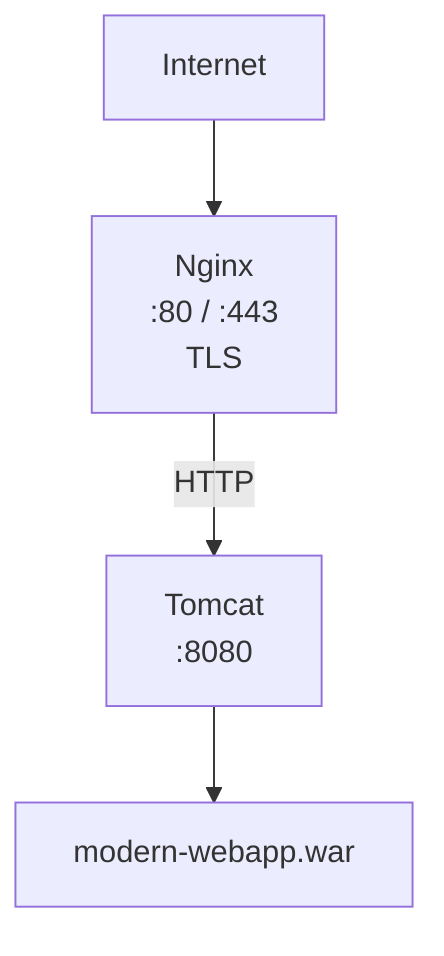
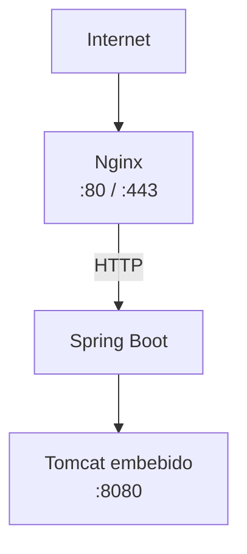
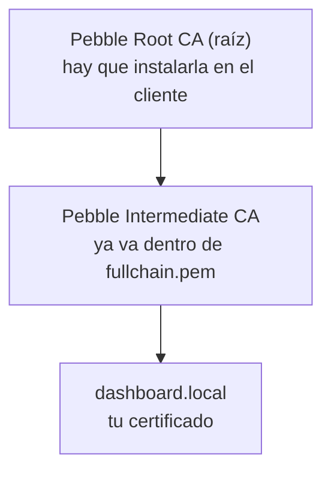
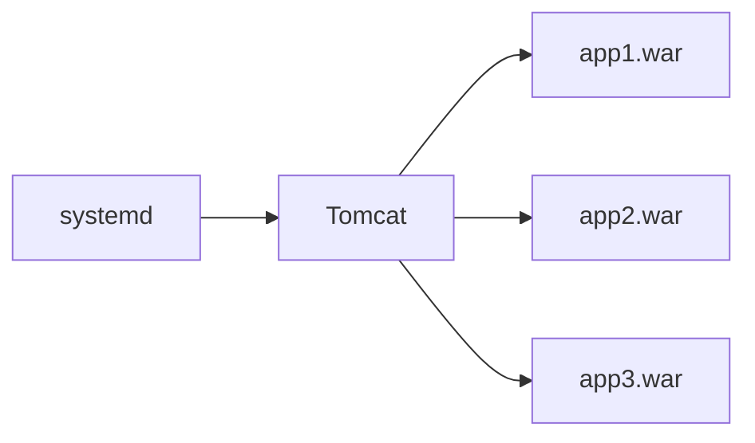
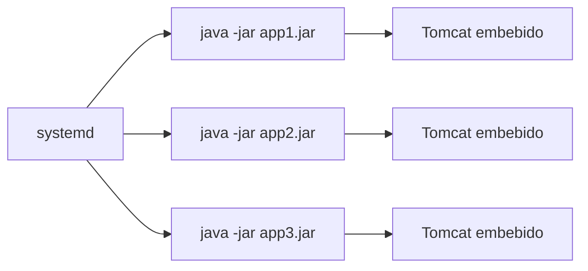

# Práctica 3.2: Despliegue de aplicaciones Java con Apache Tomcat

## Aplicación a desplegar

La aplicación Java web que desplegaremos en esta práctica está disponible en el repositorio:

[https://github.com/raul-profesor/java-dashboard](https://github.com/raul-profesor/java-dashboard)

Este repositorio contiene un proyecto Maven que genera un archivo `.war` (Web Application Archive) con un dashboard que muestra información del sistema, memoria JVM, hora del servidor, y una calculadora simple.

## Objetivos

- Comprender la arquitectura de una aplicación Java web y el rol de Tomcat como **servlet container**.
- Instalar OpenJDK y Apache Tomcat desde cero en Ubuntu.
- Configurar Tomcat como servicio de **systemd** con usuario dedicado.
- Descargar, compilar y empaquetar una aplicación Java web con Maven para generar un artefacto `.war`.
- Desplegar la aplicación en Tomcat y verificar su funcionamiento.
- Configurar **Nginx como reverse proxy** delante de Tomcat.
- Entender el protocolo **ACME** y el papel del cliente ACME.
- Obtener un certificado TLS con **certbot** usando **Pebble** (CA de pruebas de Let's Encrypt).
- Publicar la aplicación en **HTTPS** con Nginx y verificar la cadena de confianza.
- Verificar el resultado desde un navegador real usando un **contenedor Docker aislado**.
- Comparar el modelo tradicional (WAR + Tomcat externo) con el modelo moderno (JAR + Tomcat embebido).

---

## Visión global del despliegue

Este despliegue sigue un flujo lógico donde cada paso construye sobre el anterior:

1. **Instalar Java**: Necesitamos la JVM porque tanto Tomcat como la aplicación Java requieren un entorno de ejecución Java.
2. **Crear usuario dedicado**: Por seguridad, ejecutamos Tomcat con permisos mínimos, no como root.
3. **Instalar Tomcat**: Descargamos e instalamos el contenedor de servlets que ejecutará nuestra aplicación web.
4. **Configurar systemd**: Automatizamos el arranque de Tomcat para que se inicie con el sistema y se reinicie en caso de fallos.
5. **Compilar la aplicación**: Usamos Maven para descargar dependencias, compilar el código fuente y empaquetarlo en un `.war`.
6. **Desplegar el WAR**: Copiamos el artefacto compilado a Tomcat, que lo detecta y despliega automáticamente.
7. **Configurar Nginx**: Añadimos una capa de reverse proxy para mejorar seguridad, rendimiento y flexibilidad.
8. **Activar HTTPS**: Configuramos Pebble como CA de pruebas, obtenemos un certificado con certbot y publicamos la aplicación en el puerto 443.
9. **Verificar con un navegador real**: Levantamos un Chromium en Docker, con la CA de pruebas instalada, para comprobar la cadena de confianza desde la interfaz gráfica.

Cada paso es necesario: sin Java no hay JVM, sin Tomcat no hay contenedor de servlets, sin systemd no hay automatización, sin Maven no hay compilación, y sin Nginx exponemos directamente el backend. El último paso añade el cifrado TLS, sin el cual el tráfico viajaría en claro.

---

## Arquitectura que vamos a montar

### Opción A: Tomcat tradicional (Práctica 2.2a)



Tomcat actúa como **contenedor de servlets**: recibe las peticiones HTTP, las enruta al servlet correspondiente y genera la respuesta.

!!! note "Dónde termina el TLS"
    Nginx es quien gestiona el cifrado: recibe la conexión HTTPS del cliente, la descifra y reenvía la petición en HTTP plano a Tomcat por la red local. Por eso la flecha entre Nginx y Tomcat va etiquetada como `HTTP`, aunque el cliente se comunique con Nginx mediante TLS.

### Opción B: Spring Boot con Tomcat embebido (Práctica 2.2b)



En este modelo, **Tomcat vive dentro del propio JAR**. No hay un Tomcat externo que administrar.

!!! info "Concepto clave"
    En ambos casos hay una JVM y hay Tomcat. Lo que cambia es **quién controla el ciclo de vida** de Tomcat.

    - **Tradicional**: `systemd → Tomcat → aplicación.war`
    - **Spring Boot**: `systemd → java -jar app.jar → Tomcat embebido`

---

## Parte A: Despliegue tradicional (WAR + Tomcat externo)

### Paso 1: Instalar OpenJDK

Tomcat necesita una JVM (Java Virtual Machine) para ejecutarse. En Ubuntu instalamos OpenJDK:

```bash
sudo apt update
sudo apt install -y openjdk-21-jdk
```

!!! note "Requisitos de Java"
    Tomcat 11 requiere Java 17 o superior. **OpenJDK 21 LTS** es la versión recomendada para producción por ser una versión de soporte a largo plazo.

Verifica la instalación:

```bash
java -version
```

Deberías ver algo como:

```
openjdk version "21.0.x"
OpenJDK Runtime Environment (build 21.0.x)
OpenJDK 64-Bit Server VM (build 21.0.x, mixed mode, sharing)
```

Y el compilador:

```bash
javac -version
```

```
javac 21.0.x
```

**Concepto**: `java` es el intérprete de la JVM (ejecuta bytecode `.class`). `javac` es el compilador que convierte el código fuente `.java` en bytecode `.class`.

---

### Paso 2: Crear un usuario dedicado para Tomcat

No debemos ejecutar Tomcat como `root`. Por seguridad, creamos un **usuario de sistema**:

```bash
sudo useradd \
    --system \
    --home /opt/tomcat \
    --shell /usr/sbin/nologin \
    tomcat
```

| Opción | Significado |
|---|---|
| `--system` | Crea un usuario de sistema (no aparece en el login normal) |
| `--home /opt/tomcat` | Directorio home del usuario |
| `--shell /usr/sbin/nologin` | Impide que el usuario pueda iniciar sesión |

Verifica que se ha creado:

```bash
id tomcat
```

```
uid=999(tomcat) gid=999(tomcat) groups=999(tomcat)
```

**Concepto**: Ejecutar servicios con el mínimo privilegio necesario es un **principio fundamental de seguridad**. Si Tomcat se ve comprometido, el atacante solo tendrá los permisos del usuario `tomcat`, no de `root`.

---

### Paso 3: Descargar Apache Tomcat

Tomcat es un proyecto de Apache. En producción preferimos descargarlo directamente desde Apache en lugar de usar el paquete del sistema operativo, porque nos da más control sobre la versión y la ubicación de instalación.

```bash
cd /tmp
wget https://archive.apache.org/dist/tomcat/tomcat-11/v11.0.24/bin/apache-tomcat-11.0.24.tar.gz
```

!!! note "Versión de Tomcat"
    Tomcat 11 es la rama actual. Implementa las especificaciones **Jakarta EE 11** (servlets 6.1, JSP 4.0). La diferencia clave con Tomcat 9 es el cambio de namespace `javax.*` → `jakarta.*`.

---

### Paso 4: Instalar Tomcat en `/opt/tomcat`

Creamos el directorio de instalación:

```bash
sudo mkdir -p /opt/tomcat
```

Descomprimimos el archivo descargado:

```bash
sudo tar xzf apache-tomcat-11.0.24.tar.gz \
    -C /opt/tomcat \
    --strip-components=1
```

| Parámetro | Función |
|---|---|
| `xzf` | eXtract, decompress (gzipped), desde File |
| `-C /opt/tomcat` | Extraer en ese directorio |
| `--strip-components=1` | Elimina el primer nivel del path (evita crear `/opt/tomcat/apache-tomcat-11.0.24/`) |

#### Estructura de directorios de Tomcat

```
/opt/tomcat/
├── bin/          ← Scripts de arranque y parada (startup.sh, shutdown.sh)
├── conf/         ← Configuración (server.xml, web.xml, tomcat-users.xml)
├── lib/          ← Librerías compartidas (JARs de Tomcat)
├── logs/         ← Logs de Tomcat (catalina.out, localhost.log, etc.)
├── temp/         ← Archivos temporales
├── webapps/      ← Aquí se despliegan las aplicaciones (.war)
└── work/         ← Directorio de trabajo (compilación JSP → Servlet)
```

**Concepto**: Tomcat distingue entre:

- **`CATALINA_HOME`**: Donde está instalada la distribución de Tomcat (`/opt/tomcat`).
- **`CATALINA_BASE`**: Donde están los datos de una instancia concreta (permite tener varias instancias compartiendo la misma instalación).

En esta práctica ambas apuntan al mismo directorio.

---

### Paso 5: Asignar permisos

Cambiamos el propietario de todo el directorio de Tomcat al usuario `tomcat`:

```bash
sudo chown -R tomcat:tomcat /opt/tomcat
```

Aseguramos que los scripts sean ejecutables:

```bash
sudo chmod +x /opt/tomcat/bin/*.sh
```

**Concepto**: Los scripts en `bin/` necesitan permiso de ejecución para que systemd pueda arrancar Tomcat. El resto de directorios solo necesitan lectura/escritura para el usuario `tomcat`.

---

### Paso 6: Probar Tomcat manualmente

Antes de configurar systemd, verificamos que Tomcat arranca correctamente:

```bash
sudo -u tomcat /opt/tomcat/bin/startup.sh
```

Comprobamos que el puerto 8080 está escuchando:

```bash
ss -lntp | grep 8080
```

```
LISTEN  0  100  :::8080  :::*  LISTEN  12345/java
```

Verificamos que responde:

```bash
curl -s -o /dev/null -w "%{http_code}" http://localhost:8080
```

Debe devolver `200`.

Ahora paramos Tomcat para configurar systemd:

```bash
sudo -u tomcat /opt/tomcat/bin/shutdown.sh
```

**Concepto**: Esta prueba manual nos permite detectar errores de configuración (JAVA_HOME, permisos, puertos) antes de introducir la complejidad de systemd.

---

### Paso 7: Crear el servicio systemd

En un servidor moderno **no queremos arrancar Tomcat manualmente**. Usamos **systemd** para que:
- Arranque automáticamente al iniciar el sistema.
- Se reinicie si falla (`Restart=on-failure`).
- Gestione logs con `journalctl`.

Creamos el fichero de servicio:

```bash
sudo nano /etc/systemd/system/tomcat.service
```

Contenido:

```ini
[Unit]
Description=Apache Tomcat
After=network.target

[Service]
Type=forking

User=tomcat
Group=tomcat

Environment="JAVA_HOME=/usr/lib/jvm/java-21-openjdk-amd64"
Environment="CATALINA_HOME=/opt/tomcat"
Environment="CATALINA_BASE=/opt/tomcat"

ExecStart=/opt/tomcat/bin/startup.sh
ExecStop=/opt/tomcat/bin/shutdown.sh

Restart=on-failure

[Install]
WantedBy=multi-user.target
```

| Directiva | Significado |
|---|---|
| `After=network.target` | Espera a que la red esté disponible antes de arrancar |
| `Type=forking` | El proceso padre se bifurca (startup.sh lanza la JVM y termina) |
| `User/Group` | Ejecuta como el usuario y grupo `tomcat` |
| `Environment` | Variables de entorno (JAVA_HOME, CATALINA_HOME, CATALINA_BASE) |
| `ExecStart` | Comando que systemd ejecuta para arrancar el servicio |
| `ExecStop` | Comando que systemd ejecuta para parar el servicio |
| `Restart=on-failure` | Reinicia automáticamente si el proceso termina con error |
| `WantedBy=multi-user.target` | Se activa en el nivel de ejecución multi-usuario (runlevel 3) |

!!! note "JAVA_HOME"
    La ruta `/usr/lib/jvm/java-21-openjdk-amd64` puede variar según la versión exacta. Verifícala con `ls /usr/lib/jvm/`.

Recargamos la configuración de systemd:

```bash
sudo systemctl daemon-reload
```

Activamos el servicio para que arranque al inicio:

```bash
sudo systemctl enable tomcat
```

Arrancamos Tomcat:

```bash
sudo systemctl start tomcat
```

Verificamos el estado:

```bash
sudo systemctl status tomcat
```

Deberías ver `active (running)`.

Consultar logs en tiempo real:

```bash
journalctl -u tomcat -f
```

---

### Paso 8: Descargar y construir la aplicación con Maven

Ahora vamos a descargar la aplicación desde GitHub y compilarla para generar el `.war`.

Para ello primero instalamos Maven si no lo tenemos:

```bash
sudo apt install -y maven
mvn -version
```

#### Clonar el repositorio

Primero clonamos el proyecto desde GitHub:

```bash
cd /tmp
git clone https://github.com/raul-profesor/java-dashboard.git
cd java-dashboard
```

!!! note "Contenido de la aplicación"
    Este repositorio contiene una aplicación Java web completa con un dashboard que muestra información del sistema, memoria JVM, hora del servidor, y una calculadora.

#### Estructura del proyecto Maven

El proyecto sigue la estructura estándar de Maven:

```
java-dashboard/
├── pom.xml                 ← Descriptor del proyecto Maven (Project Object Model)
└── src/
    └── main/
        ├── java/           ← Código fuente Java (.java)
        │   └── com/example/webapp/
        │       └── HomeServlet.java
        ├── resources/      ← Archivos de configuración (properties, XML)
        └── webapp/         ← Recursos web (JSPs, HTML, CSS, JS)
            ├── index.jsp
            └── WEB-INF/
                └── web.xml
```

**Concepto**: Maven organiza el proyecto de forma estandarizada. Esta estructura permite que cualquier desarrollador o herramienta entienda dónde está el código fuente, los recursos y la configuración. La carpeta `src/main/java` contiene el código Java, `src/main/webapp` contiene los recursos web (JSPs, HTML, CSS), y `pom.xml` describe las dependencias y cómo construir el proyecto.

#### `pom.xml` — Descriptor del proyecto Maven

El fichero `pom.xml` es el corazón de Maven. Define qué dependencias necesita el proyecto, cómo compilarlo y qué artefacto generar. Vamos a ver las partes clave:

```xml
<project xmlns="http://maven.apache.org/POM/4.0.0">
    <modelVersion>4.0.0</modelVersion>

    <!-- Coordenadas del proyecto: identifican único al artefacto -->
    <groupId>com.example</groupId>           <!-- Organización o grupo -->
    <artifactId>modern-webapp</artifactId>   <!-- Nombre del proyecto -->
    <version>1.0</version>                    <!-- Versión -->
    <packaging>war</packaging>                <!-- Tipo de artefacto: WAR (Web Application Archive) -->

    <!-- Propiedades de compilación -->
    <properties>
        <maven.compiler.source>21</maven.compiler.source>   <!-- Versión de Java fuente -->
        <maven.compiler.target>21</maven.compiler.target>   <!-- Versión de Java objetivo -->
    </properties>

    <!-- Dependencias: librerías que necesita el proyecto -->
    <dependencies>
        <dependency>
            <groupId>jakarta.servlet</groupId>
            <artifactId>jakarta.servlet-api</artifactId>
            <version>6.0.0</version>
            <scope>provided</scope>
        </dependency>
    </dependencies>

    <!-- Configuración de compilación -->
    <build>
        <finalName>modern-webapp</finalName>  <!-- Nombre del WAR final sin versión -->
    </build>
</project>
```

**Explicación de los elementos clave**:

- **`groupId`, `artifactId`, `version`**: Son las coordenadas Maven que identifican de forma única el artefacto. Piensa en esto como un DNI para tu proyecto. Por ejemplo, `com.example:modern-webapp:1.0`.

- **`packaging=war`**: Indica que el resultado final será un archivo `.war` (Web Application Archive). Maven podría generar JARs, WARs, EARs, etc. Para aplicaciones web, usamos WAR.

- **`dependencies`**: Lista de librerías externas que el proyecto necesita. En este caso, necesitamos la API de servlets Jakarta EE para poder crear servlets.

- **`scope=provided`**: Esta dependencia la proporciona el contenedor (Tomcat), **no se incluye en el WAR**. Tomcat ya tiene su propia implementación de la API de servlets, así que no necesitamos empaquetarla. Si la incluyéramos, habría conflictos de versiones.

- **`finalName`**: Define el nombre del artefacto final. En lugar de `modern-webapp-1.0.war`, generará `modern-webapp.war`. Esto es importante porque el nombre del WAR determina la URL de la aplicación (`/modern-webapp/`).

**Concepto**: El `pom.xml` actúa como un "Makefile" inteligente. Maven lee este fichero, descarga automáticamente las dependencias desde repositorios centrales (Maven Central), compila el código, ejecuta tests (si los hay), y empaqueta todo en el formato especificado. Todo esto con un solo comando.

#### `HomeServlet.java` — El servlet principal

```java
@WebServlet("/")
public class HomeServlet extends HttpServlet {
    @Override
    protected void doGet(HttpServletRequest request,
                         HttpServletResponse response) {
        request.setAttribute("serverTime", LocalDateTime.now());
        request.getRequestDispatcher("/index.jsp")
                .forward(request, response);
    }
}
```

| Concepto | Explicación |
|---|---|
| `@WebServlet("/")` | Anotación que mapea el servlet a la ruta raíz (`/`) |
| `extends HttpServlet` | Hereda de la clase base de servlets HTTP |
| `doGet()` | Maneja las peticiones HTTP GET |
| `request.setAttribute()` | Pasa datos al JSP para que los muestre |
| `forward()` | Delega la respuesta al JSP |

**Concepto**: Un **servlet** es una clase Java que extiende `HttpServlet` y procesa peticiones HTTP. Tomcat instancia el servlet y llama a sus métodos `doGet()`, `doPost()`, etc. La anotación `@WebServlet` registra el servlet automáticamente sin necesidad de configurarlo en `web.xml`.

#### Compilar el proyecto

```bash
cd java-proyecto
mvn clean package
```

| Fase | Acción |
|---|---|
| `clean` | Elimina el directorio `target/` (limpieza de compilaciones anteriores) |
| `compile` | Compila el código fuente `.java` a bytecode `.class` |
| `test` | Ejecuta las pruebas unitarias (si las hay) |
| `package` | Empaqueta el resultado en el formato definido (`war`) |

Resultado:

```
target/
├── classes/              ← Bytecode .class compilado
├── modern-webapp/        ← WAR desempaquetado
└── modern-webapp.war     ← Artefacto final para desplegar
```

**Concepto**: Un archivo `.war` es esencialmente un `.zip` con una estructura específica que Tomcat puede desplegar automáticamente. Contiene los `.class`, JSPs, `web.xml` y recursos estáticos.

---

### Paso 9: Desplegar el WAR en Tomcat

Copiamos el WAR al directorio de despliegue de Tomcat:

```bash
sudo cp /tmp/java-dashboard/target/modern-webapp.war /opt/tomcat/webapps/
```

Tomcat detectará automáticamente el nuevo WAR y lo desplegará:

```
/opt/tomcat/webapps/
├── modern-webapp.war
└── modern-webapp/        ← Desplegado automáticamente
    ├── index.jsp
    ├── META-INF/
    └── WEB-INF/
        ├── classes/
        └── web.xml
```

La aplicación será accesible en:

```
http://<IP_SERVIDOR>:8080/modern-webapp/
```

Verificamos:

```bash
curl -s http://localhost:8080/modern-webapp/ | head -20
```

Deberías ver el HTML de la página.

**Concepto**: El **auto-deploy** de Tomcat consiste en:
1. Detectar un nuevo archivo `.war` en `webapps/`.
2. Descomprimirlo en un directorio con el mismo nombre.
3. Registrar la aplicación y hacerla accesible en el contexto correspondiente (`/modern-webapp/`).

---

### Paso 10: Configurar Nginx como reverse proxy

No exponemos Tomcat directamente en el puerto 8080. Usamos **Nginx como reverse proxy** para:

- Terminar las conexiones TLS (HTTPS).
- Balancear carga entre varios backends.
- Servir archivos estáticos directamente (mejor rendimiento).
- Añadir cabeceras de seguridad.
- Ocultar los detalles del backend al cliente.

Instalamos Nginx:

```bash
sudo apt install -y nginx
```

Creamos la configuración del sitio:

```bash
sudo nano /etc/nginx/sites-available/tomcat
```

```nginx
server {
    listen 80;
    server_name _;

    access_log /var/log/nginx/tomcat.access.log;
    error_log /var/log/nginx/tomcat.error.log;

    location / {
        proxy_pass http://127.0.0.1:8080;
        proxy_set_header Host $host;
        proxy_set_header X-Real-IP $remote_addr;
        proxy_set_header X-Forwarded-For $proxy_add_x_forwarded_for;
        proxy_set_header X-Forwarded-Proto $scheme;
    }
}
```

| Directiva | Función |
|---|---|
| `proxy_pass` | Reenvía la petición a Tomcat en localhost:8080 |
| `Host $host` | Envía el host original al backend |
| `X-Real-IP` | Informa a Tomcat de la IP real del cliente |
| `X-Forwarded-For` | Cadena de proxies por los que pasó la petición |
| `X-Forwarded-Proto` | Protocolo original (http o https) |

Activamos el sitio:

```bash
sudo ln -s /etc/nginx/sites-available/tomcat /etc/nginx/sites-enabled/
sudo rm -f /etc/nginx/sites-enabled/default
sudo nginx -t
sudo systemctl restart nginx
```

Ahora la aplicación es accesible en:

```
http://<IP_SERVIDOR>/modern-webapp/
```

---

### Paso 11: Añadir HTTPS con certificado de Pebble

Hasta ahora Nginx sirve tráfico en **HTTP plano** (puerto 80). Las contraseñas, cookies y datos viajan sin cifrar: cualquiera que escuche la red puede verlos. Para proteger la comunicación necesitamos **HTTPS** (HTTP sobre TLS).

En producción, los certificados TLS los emite una **Autoridad Certificadora (CA)** como Let's Encrypt. En esta práctica usaremos **Pebble**, que es la **CA de pruebas oficial de Let's Encrypt**. Es idéntica en funcionamiento, pero pensada para testing: sin límites de peticiones, sin listas de espera, y con su propia raíz de confianza (no confiable por defecto).

#### 11.1 ¿Qué es ACME y qué es un cliente ACME?

**ACME** (Automatic Certificate Management Environment, RFC 8555) es el **protocolo** que estandariza cómo un servidor solicita certificados TLS a una CA. Es el mismo protocolo que usa Let's Encrypt en producción.

Un **cliente ACME** es el software que se ejecuta en tu servidor y habla ACME con la CA. Su trabajo es:

1. Generar un par de claves (pública/privada) para tu dominio.
2. Pedir un certificado a la CA, enviando la clave pública.
3. Superar un **challenge** (validación): demostrar que controlas el dominio. Típicamente colocando un fichero en `/.well-known/acme-challenge/` que la CA verifica por HTTP.
4. Recibir el certificado firmado por la CA.
5. Instalarlo donde corresponda (Nginx, Apache, etc.).
6. Renovarlo automáticamente antes de que expire.

Ejemplos de clientes ACME: **certbot** (el oficial de la EFF), **acme.sh** (script bash puro), **lego** (escrito en Go), o **Caddy** (servidor web con cliente ACME integrado).

En esta práctica usaremos **certbot** apuntando a **Pebble** (nuestra CA de pruebas) en lugar de a Let's Encrypt. El flujo es idéntico; solo cambia con quién hablamos.

##### ¿Qué es certbot?

**Certbot** es el cliente ACME de referencia, el más usado y el mantenido por la **EFF** (Electronic Frontier Foundation). Es un programa de línea de comandos que se instala en tu servidor y se encarga de todo el proceso de gestión de certificados TLS: pedirlo a la CA, validarlo, instalarlo y renovarlo.

No es un servidor web ni un proxy: es simplemente el "intermediario" que habla ACME con la CA en tu nombre. Si mañana cambiaras Pebble por Let's Encrypt, o Pebble por ZeroSSL, **los mismos comandos de certbot seguirían funcionando**: solo cambiaría la URL del `--server`.

**Estructura en el disco**

Cuando instalas certbot, sus datos viven en `/etc/letsencrypt/`:

```
/etc/letsencrypt/
├── accounts/      ← Las cuentas ACME (tus credenciales ante la CA)
├── archive/       ← Historial: cada renovación crea una carpeta con los .pem
├── live/          ← Enlaces simbólicos a la versión actual de cada dominio
│   └── dashboard.local/
│       ├── cert.pem        → certificate
│       ├── chain.pem       → chain
│       ├── fullchain.pem   → fullchain
│       └── privkey.pem     → private_key
└── renewal/       ← Configuración para automatizar la renovación
```

!!! info "Por qué `live/` son enlaces simbólicos"
    Cuando certbot renueva un certificado, crea una versión nueva en `archive/` (con fecha y número) y **reapunta** los enlaces de `live/`. Como Nginx apunta siempre a la ruta fija `/etc/letsencrypt/live/dashboard.local/fullchain.pem`, tras la renovación solo hace falta **recargar Nginx** (`sudo systemctl reload nginx`) para que use el certificado nuevo. Si en cambio configurás Nginx con la ruta de `archive/`, tendrías que editar la configuración cada vez.

**Modos de uso**

Certbot ofrece dos formas de trabajar, y en esta práctica usaremos la segunda:

| Modo | Qué hace | Cuándo usarlo |
|---|---|---|
| `certbot run` (modo *server*) | Emite el certificado **y además** modifica la configuración del servidor web (Nginx, Apache) para usarlo | Cuando quieres que certbot lo haga todo de una vez |
| `certbot certonly` | Solo emite el certificado y lo deja en `live/`. **Tú** configuras el servidor | Cuando quieres controlar la configuración a mano, como en esta práctica |

**Renovación automática**

Al ejecutar `certbot`, además de emitir el certificado, instala un `timer` de systemd que lo renueva antes de que expire. Puedes comprobarlo:

```bash
sudo systemctl list-timers | grep certbot
```

!!! note "En esta práctica la renovación no es real"
    Pebble es una CA de pruebas y los certificados que emite caducan o dejan de ser válidos en cuanto reinicias Pebble. El mecanismo de renovación existe y funciona igual que en producción, pero contra Pebble no aporta nada. Lo que sí es real es el mecanismo: el `timer`, la carpeta `renewal/` y los enlaces simbólicos.

##### ¿Por qué usar certbot y no hacerlo a mano?

Pedir un certificado manualmente no es imposible, pero certbot resuelve por ti los cinco problemas que aparecen en producción:

| Problema | Cómo lo resuelve certbot |
|---|---|
| **La clave privada** | La genera y la guarda con permisos correctos (`0600`). Si la generas tú, es fácil dejarla legible para todo el mundo |
| **La renovación** | Los certificados duran poco (90 días en Let's Encrypt). Certbot instala un `timer` de systemd que los renueva **sin que nadie se entere** |
| **El formato de la cadena** | Coloca los ficheros en `/etc/letsencrypt/live/` con los nombres estándar (`fullchain.pem`, `privkey.pem`) y actualiza los enlaces simbólicos al renovar |
| **El mecanismo de challenge** | `--standalone`, `--webroot` y `--dns` cubren los distintos casos: levantar su propio servidor web, usar un directorio web existente, o delegar la validación en un proveedor DNS |
| **El estado** | Guarda la cuenta ACME, los certificados y su historial en un sitio estándar (`/etc/letsencrypt/`) |

!!! info "`fullchain.pem` vs `cert.pem`"
    `fullchain.pem` incluye el certificado de tu dominio **más** el de la CA intermedia. Nginx necesita la cadena completa para que el cliente pueda validar hasta la raíz. Si solo sirves `cert.pem`, el navegador lo rechazará por "cadena incompleta". Lo veremos en detalle en el Paso 11.7.

!!! tip "Para saber más"
    ACME soporta varios métodos de validación (`http-01`, `tls-alpn-01`, `dns-01`). Nosotros usamos `http-01` por simplicidad. La [RFC 8555](https://datatracker.ietf.org/doc/html/rfc8555) describe el protocolo completo.

#### 11.2 Instalar Pebble

Descargamos el binario desde GitHub:

```bash
cd /tmp
wget https://github.com/letsencrypt/pebble/releases/download/v2.10.1/pebble-linux-amd64.tar.gz
tar -xzf pebble-linux-amd64.tar.gz
sudo mv pebble-linux-amd64/linux/amd64/pebble /usr/local/bin/pebble
sudo chmod +x /usr/local/bin/pebble
```

Verificamos la instalación:

```bash
pebble --version
```

#### 11.3 Configurar y arrancar Pebble

Pebble necesita un fichero de configuración. Creamos uno básico:

```bash
sudo mkdir -p /etc/pebble
sudo nano /etc/pebble/pebble-config.json
```

Contenido:

```json
{
  "pebble": {
    "listenAddress": "0.0.0.0:14000",
    "managementListenAddress": "0.0.0.0:15000",
    "certificate": "/etc/pebble/cert.pem",
    "privateKey": "/etc/pebble/key.pem",
    "httpPort": 80,
    "tlsPort": 443,
    "ocspResponderURL": ""
  }
}
```

| Campo | Significado |
|---|---|
| `listenAddress` | Puerto ACME (14000) — al que apuntará certbot |
| `managementListenAddress` | Puerto de gestión (15000) — para consultar certificados emitidos |
| `certificate` / `privateKey` | TLS de la propia API de Pebble (no del certificado que emite) |
| `httpPort` | Puerto donde Pebble valida challenges HTTP-01 (80 para coincidir con certbot --standalone) |
| `tlsPort` | Puerto donde Pebble valida challenges TLS-ALPN-01 (443) |

!!! info "¿Por qué dos puertos de validación?"
    Pebble necesita validar que controlas el dominio. Para el challenge `http-01`, Pebble se conecta al puerto 80 de tu dominio y descarga un fichero especial. Para `tls-alpn-01`, se conecta al puerto 443. Por defecto, Pebble usa puertos no estándar (5002 y 5001) para evitar conflictos, pero como nosotros paramos Nginx y certbot escucha en el puerto 80, configuramos Pebble para que valide en los puertos estándar.

Descargamos los certificados de prueba que usa la **API de Pebble** (puerto 14000):

```bash
cd /etc/pebble
sudo wget -O cert.pem https://raw.githubusercontent.com/letsencrypt/pebble/main/test/certs/localhost/cert.pem
sudo wget -O key.pem https://raw.githubusercontent.com/letsencrypt/pebble/main/test/certs/localhost/key.pem
sudo wget -O api-ca.pem https://raw.githubusercontent.com/letsencrypt/pebble/main/test/certs/pebble.minica.pem
```

| Fichero | Para qué sirve |
|---|---|
| `cert.pem` / `key.pem` | El certificado TLS que usa Pebble para su propia API (puerto 14000) |
| `api-ca.pem` | La CA que **firmó** ese certificado de la API. La usaremos con `REQUESTS_CA_BUNDLE` para que certbot confíe en Pebble |

!!! info "Dos CAs distintas, no confundir"
    Pebble usa una CA diferente para cada cosa:

    - **`api-ca.pem`** (la del repositorio) firma el certificado TLS de la **API de Pebble** en el puerto 14000. Es la que necesita confiar el cliente ACME (certbot) para poder hablar con Pebble.
    - **La CA que emite tus certificados** (raíz + intermedia) la **genera Pebble en cada arranque** y **no está en el repositorio**: se descarga desde la API de gestión, en el puerto 15000. Lo veremos en el Paso 11.7.

Arrancamos Pebble en segundo plano con la variable `PEBBLE_VA_NOSLEEP=1` para que valide los challenges inmediatamente sin esperar:

```bash
sudo PEBBLE_VA_NOSLEEP=1 pebble -config /etc/pebble/pebble-config.json &
```

Verificamos que está escuchando:

```bash
ss -lntp | grep -E '14000|15000'
```

Deberías ver ambos puertos en estado LISTEN.

!!! note "Pebble como servicio"
    En un entorno real, empaquetarías Pebble como servicio systemd (siguiendo el patrón del Paso 7). Para esta práctica, arrancarlo en background es suficiente.

#### 11.4 Configurar el dominio local

Pebble validará que controlamos el dominio. Como no tenemos un dominio real, usaremos `dashboard.local` y lo apuntaremos a localhost:

```bash
echo "127.0.0.1 dashboard.local" | sudo tee -a /etc/hosts
```

Verificamos:

```bash
ping -c 1 dashboard.local
```

Debería resolver a `127.0.0.1`.

!!! info "¿Por qué un dominio y no una IP?"
    Los certificados TLS están ligados a un **nombre de dominio**, no a una IP. Cuando tu navegador conecta a `https://dashboard.local`, verifica que el certificado fue emitido para ese nombre exacto. Si usáramos la IP directamente, el certificado no sería válido.

#### 11.5 Instalar certbot y emitir el certificado

Instalamos certbot:

```bash
sudo apt install -y certbot
```

##### Preparar el terreno

Antes de pedir el certificado, **paramos Nginx temporalmente**. El challenge `http-01` requiere que Pebble acceda a `http://dashboard.local/.well-known/acme-challenge/<token>`, y certbot en modo `--standalone` levanta su propio servidor web en el **puerto 80** para servir ese fichero. Si Nginx ya está escuchando ahí, certbot no puede vincularse.

```bash
sudo systemctl stop nginx
```

!!! info "Pebble es stateless"
    Cada vez que reinicias Pebble pierde todas las cuentas y certificados previos. Si ya habías ejecutado certbot antes y reiniciaste Pebble, verás el error `Account not found`. Solución:
    ```bash
    sudo rm -rf /etc/letsencrypt/accounts/localhost:14000
    ```
    Con eso certbot registra una cuenta nueva en el Pebble que acabas de arrancar.

##### Pedir el certificado

```bash
sudo REQUESTS_CA_BUNDLE=/etc/pebble/api-ca.pem certbot certonly \
    --standalone \
    --server https://localhost:14000/dir \
    --domains dashboard.local \
    --agree-tos \
    --non-interactive \
    --email admin@local
```

| Parámetro | Función |
|---|---|
| `--certonly` | Solo pide el certificado; no toca la configuración del servidor web |
| `--standalone` | Certbot levanta su propio servidor web temporal en el puerto 80 para responder al challenge |
| `--server` | Endpoint ACME de Pebble (en lugar de Let's Encrypt) |
| `--domains` | Dominio para el que pedimos el certificado |
| `--agree-tos` | Acepta los términos de servicio |
| `--non-interactive` | No hace preguntas (imprescindible para scripts y para CI) |
| `REQUESTS_CA_BUNDLE` | Le dice a certbot (Python) que confíe en la CA de la API de Pebble |

!!! info "`REQUESTS_CA_BUNDLE`"
    Certbot está escrito en Python y, antes de hablar con Pebble, valida el certificado TLS de la API. Como esa CA no está en el almacén del sistema, le decimos "usa esta en su lugar" con esta variable. Es necesario solo mientras hablamos con Pebble: los certificados que certbot emite son de Pebble, no de la API.

Una vez obtenido el certificado, **reiniciamos Nginx**:

```bash
sudo systemctl start nginx
```

##### Comprobar los ficheros generados

```bash
sudo ls -la /etc/letsencrypt/live/dashboard.local/
```

| Fichero | Contenido |
|---|---|
| `cert.pem` | El certificado de tu dominio |
| `chain.pem` | La CA intermedia |
| `fullchain.pem` | `cert.pem` + `chain.pem` — el que usará Nginx |
| `privkey.pem` | La clave privada |

En `live/` estos ficheros son **enlaces simbólicos** a `archive/`, que guarda el histórico. Al renovar, certbot crea una versión nueva en `archive/` y repunta el enlace. Por eso Nginx puede tener la ruta fija `/etc/letsencrypt/live/dashboard.local/fullchain.pem` y no hay que tocar nada al renovar.

#### 11.6 Reconfigurar Nginx con HTTPS

Ahora reemplazamos la configuración HTTP de Nginx por HTTPS. Abrimos el fichero:

```bash
sudo nano /etc/nginx/sites-available/tomcat
```

Contenido nuevo:

```nginx
server {
    listen 443 ssl;
    server_name dashboard.local;

    ssl_certificate     /etc/letsencrypt/live/dashboard.local/fullchain.pem;
    ssl_certificate_key /etc/letsencrypt/live/dashboard.local/privkey.pem;

    access_log /var/log/nginx/tomcat.access.log;
    error_log /var/log/nginx/tomcat.error.log;

    location / {
        proxy_pass http://127.0.0.1:8080;
        proxy_set_header Host $host;
        proxy_set_header X-Real-IP $remote_addr;
        proxy_set_header X-Forwarded-For $proxy_add_x_forwarded_for;
        proxy_set_header X-Forwarded-Proto $scheme;
    }
}

server {
    listen 80;
    server_name dashboard.local;
    return 301 https://$host$request_uri;
}
```

| Directiva | Función |
|---|---|
| `listen 443 ssl` | Nginx escucha en el puerto HTTPS y activa TLS |
| `ssl_certificate` | Ruta al certificado completo (fullchain) |
| `ssl_certificate_key` | Ruta a la clave privada |
| `return 301 https://...` | Redirige todo el tráfico HTTP a HTTPS |

!!! info "Terminación TLS en Nginx"
    Cuando Nginx escucha en `:443 ssl`, se encarga de **terminar la conexión TLS**: descifra la petición del cliente, y reenvía el tráfico ya en claro a Tomcat por HTTP interno. Tomcat no sabe criptografía — solo habla HTTP. Nginx actúa como "traductor seguro". Esto es muy común en arquitecturas modernas: el reverse proxy gestiona TLS, el backend solo habla HTTP.

!!! info "¿Por qué redirigir 80 → 443?"
    Aunque nuestra app solo funciona por HTTPS, mantenemos el listener en `:80` para redirigir automáticamente. Si un usuario escribe `http://...`, nunca verá un error: irá rebotado a la versión segura. Es una buena práctica universal.

!!! info "`X-Forwarded-Proto` (ahora con sentido completo)"
    Tomcat recibe la petición por HTTP desde Nginx, así que no sabe si el cliente original usó HTTPS. La cabecera `X-Forwarded-Proto: https` se lo indica. Esto es importante si la aplicación Java genera cookies con el flag `Secure` o URLs absolutas.

Verificamos la sintaxis y reiniciamos:

```bash
sudo nginx -t
sudo systemctl reload nginx
```

!!! note "Permisos de los certificados"
    Si Nginx no puede leer los certificados (permisos), añade el usuario `nginx` al grupo `letsencrypt`:
    ```bash
    sudo chmod 755 /etc/letsencrypt/live
    sudo chmod 644 /etc/letsencrypt/live/dashboard.local/*.pem
    ```

#### 11.7 Instalar la CA raíz de Pebble en el servidor

Hasta ahora, si pruebas con `curl` desde el servidor, obtendrás un error de certificado. ¿Por qué?

!!! info "Cadena de confianza"
    Un certificado TLS no funciona solo: está firmado por una **CA intermedia**, que a su vez está firmada por una **CA raíz**. El cliente confía en la raíz y, por ese aval, acepta toda la cadena. Es como un cheque: tu banco (raíz) avala a una sucursal (intermedia), y tú aceptas el cheque de la sucursal (hoja). Si el cliente no conoce ninguna raíz que valide a la sucursal, rechaza el cheque.

La jerarquía que ha creado Pebble es esta:



!!! info "Clave: Pebble genera su CA en cada arranque"
    A diferencia de Let's Encrypt (cuya raíz es pública y estable), **Pebble crea una CA raíz y una intermedia nuevas cada vez que arranca**. Por eso su raíz **no está en el repositorio GitHub**: hay que descargarla de la API de gestión, en el puerto 15000.

##### Descargar la CA raíz

```bash
cd /tmp
curl -k https://localhost:15000/roots/0 -o pebble-root.pem
```

!!! note "El flag `-k` de curl"
    La API de gestión de Pebble también usa TLS con un certificado de prueba, así que `curl` lo rechazaría. Con `-k` (`--insecure`) le decimos que no verifique la cadena. Es aceptable aquí porque la descarga es local y después validamos el contenido con `openssl`.

Verificamos que es un certificado válido:

```bash
openssl x509 -in pebble-root.pem -noout -subject -issuer
```

El Subject y el Issuer deben ser **iguales** (una CA raíz se firma a sí misma):

```
subject=O = Pebble Root CA 8fa1a2b3c4d5e6f7
issuer=O = Pebble Root CA 8fa1a2b3c4d5e6f7
```

##### Instalar la raíz en el almacén del sistema

```bash
sudo cp pebble-root.pem /usr/local/share/ca-certificates/pebble-root.crt
sudo update-ca-certificates
```

Debes ver `1 added`.

!!! info "`update-ca-certificates`"
    Este comando copia tus `.crt` de `/usr/local/share/ca-certificates/` al almacén del sistema en `/etc/ssl/certs/`. Cada distribución tiene su mecanismo; en Debian/Ubuntu es este. A partir de ahora, los programas que usan el almacén del sistema (`curl`, `openssl`, Java, Chrome) confían en la raíz de Pebble.

!!! note "«0 added, 0 removed» no es un error"
    El número indica cuántos certificados *nuevos* se han incorporado. Si muestra `0 added, 0 removed`, es que ese certificado ya estaba instalado de un intento anterior.

##### Verificar la cadena que sirve Nginx

```bash
echo | openssl s_client -connect dashboard.local:443 -servername dashboard.local 2>/dev/null \
  | grep -E "^ *[0-9] s:|^ *i:"
```

Deberías ver **dos** niveles:

```
 0 s:C = US, O = Pebble Root CA 8fa1a2b3c4d5e6f7
   i:C = US, O = Pebble Intermediate CA 1234567890
 1 s:C = US, O = Pebble Intermediate CA 1234567890
   i:C = US, O = Pebble Root CA 8fa1a2b3c4d5e6f7
```

El nivel `0` es tu certificado (`dashboard.local`) y el `1` es la intermedia, que viaja dentro de `fullchain.pem`. Si solo apareciera un nivel, Nginx estaría sirviendo `cert.pem` en lugar de `fullchain.pem` y habría que corregir la configuración.

##### Limpiar la CA antigua (si instalaste una en un intento previo)

```bash
sudo rm -f /usr/local/share/ca-certificates/pebble.crt
sudo update-ca-certificates
```

#### 11.8 Verificación

##### Desde el servidor (obligatorio)

Con `curl`:

```bash
curl -v https://dashboard.local/modern-webapp/
```

Debes ver el HTML de la aplicación y, entre las líneas de log, esta:

```
* SSL certificate verify ok.
```

Con `openssl`, para ver el certificado en detalle:

```bash
echo | openssl s_client -connect dashboard.local:443 -servername dashboard.local 2>/dev/null | openssl x509 -noout -text
```

Busca estas líneas:

```
Issuer:  O = Pebble Intermediate CA 1234567890
Subject: CN = dashboard.local
```

##### Desde el navegador del cliente (opcional)

Si abres `https://dashboard.local/modern-webapp/` desde el navegador de **tu portátil**, verás un aviso de que el certificado no es confiable. Esto es **lo esperado**, y no indica ningún fallo en la configuración del servidor.

!!! info "El almacén de confianza es del cliente, no del servidor"
    Instalar la CA raíz en el servidor (Paso 11.7) afecta **solo a los programas que se ejecutan en esa máquina**: `curl`, `openssl`, Java, Tomcat. El navegador de tu portátil es otro programa, en **otra máquina**, con **su propio almacén de CAs**. Que el servidor confíe en su propia CA no cambia nada en el navegador: el navegador nunca ha visto esa raíz y, con razón, no se fía.

Por tanto hay tres escenarios, y todos son correctos:

| Escenario | Resultado | ¿Qué hacer? |
|---|---|---|
| El navegador se ejecuta **en el servidor** (por ejemplo, con `lynx` o `w3m` en terminal) | Usa el almacén del sistema → **candado verde**, sin avisos | Ninguno: ya funciona |
| El navegador se ejecuta **en tu portátil** | Usa su propio almacén → **aviso de certificado no confiable** | Ninguno: el aviso es correcto, la CA es de pruebas |
| El navegador se ejecuta **en un contenedor Docker** con la CA instalada | Usa un almacén con la CA de Pebble → **candado verde** | Ver la subsección siguiente |

Si quisieras ver el candado verde en el navegador de tu portátil, tendrías que instalar `pebble-root.pem` como CA de confianza **en tu portátil** (doble clic → "Instalar certificado" en Windows, "Keychain Access" en macOS, o `update-ca-certificates` en Linux). **No lo hagas en esta práctica**: la clave privada de la CA de Pebble es pública y está en su repositorio, así que cualquiera podría emitir certificados que tu navegador daría por buenos.

##### Ver el candado verde: un navegador aislado en Docker (opcional)

Si quieres que el alumno **vea el candado verde** sin tocar su propio equipo, la solución es montar un navegador dentro de un contenedor Docker, con la CA de Pebble ya instalada, y que el alumno lo visualice a través del navegador desde su portátil.

La idea es que el contenedor acts como un "navegador de referencia": tiene la CA de pruebas en su almacén de confianza, así que valida el certificado correctamente y muestra la página como lo haría un navegador de producción con una CA real.

**Arquitectura**

En este laboratorio el contenedor no se ejecuta en el mismo servidor que el dashboard, sino en **otra máquina**:

```
[Servidor A]                    [Servidor B]                    [Portátil del alumno]
Dashboard.local                 Contenedor Docker               Navegador
  - Tomcat :8080                - Chromium                      (normal, sin tocar
  - Nginx :443                    + CA de Pebble                   su configuración)
  - Pebble :14000/:15000        - noVNC :3001
    IP: <IP_A>                    IP: <IP_B>
```

El flujo completo es:

1. El alumno abre `http://<IP_B>:3000` en el navegador de su portátil.
2. Ve un escritorio virtual con Chromium ya abierto.
3. Chromium resuelve `dashboard.local` → `<IP_A>` (gracias a la entrada que inyectamos en `/etc/hosts` del contenedor).
4. Se conecta a `https://dashboard.local/...`; Nginx en A sirve el certificado.
5. Chromium valida la cadena porque tiene la CA de Pebble en su almacén → **candado verde**.

**Preparar la máquina del contenedor (Servidor B)**

Necesitamos el fichero `pebble-root.pem` en B. Lo copiamos desde el servidor A (donde lo descargamos en el Paso 11.7):

```bash
# Desde el servidor A
scp /tmp/pebble-root.pem usuario@<IP_B>:/tmp/
```

Y en B comprobamos que Docker está instalado:

```bash
docker --version
```

**Crear el script de inicialización del contenedor**

El contenedor necesita tres cosas al arrancar: apuntar `dashboard.local` a la IP del servidor A, instalar la CA en el almacén de Chromium y abrir la URL. Creamos un script en B:

```bash
mkdir -p ~/dashboard-browser
cd ~/dashboard-browser
nano entrypoint.sh
```

Contenido:

```bash
#!/bin/bash
set -e

# 1. Resolver dashboard.local hacia el servidor donde corre el dashboard
DASHBOARD_IP="${DASHBOARD_IP:?Falta indicar la IP del servidor del dashboard}"
echo "${DASHBOARD_IP} dashboard.local" >> /etc/hosts

# 2. Instalar la CA de Pebble en el trust store del sistema
cp /certs/pebble-root.pem /usr/local/share/ca-certificates/pebble-root.crt
update-ca-certificates

# 3. Chromium no usa el trust store del sistema, sino su propia base NSS
#    (Chrome Root Store, desde la v107). Hay que importar la CA también ahí.
apt-get update
apt-get install -y libnss3-tools
mkdir -p /config/.pki/nssdb
certutil -d sql:/config/.pki/nssdb -N --empty-password
certutil -d sql:/config/.pki/nssdb -A -t "C,," -n "Pebble Root CA" \
    -i /usr/local/share/ca-certificates/pebble-root.crt

# 4. Delegar el arranque en el script original de la imagen
exec /init
```

!!! info "Por qué dos almacenes de confianza"
    `update-ca-certificates` actualiza el almacén del sistema (`/etc/ssl/certs/`), que usan `curl`, `openssl`, `wget` o cualquier programa basado en OpenSSL. Pero **Chromium no lo usa**: desde la versión 107 mantiene su propio *Chrome Root Store*, respaldado por una base de datos NSS en `~/.pki/nssdb`. Por eso hay que importar la CA **dos veces**: una en el almacén del sistema (para las utilidades de línea de comandos) y otra en la base NSS (para el navegador). Es un detalle que sorprende y que conviene conocer.

!!! note "El script original de la imagen"
    La imagen de LinuxServer usa [s6-overlay](https://github.com/just-containers/s6-overlay) para supervisar los servicios internos. El comando `exec /init` es el punto de entrada real del contenedor; nuestro script solo prepara el entorno y luego le pasa el control. Si no ejecutáramos `exec /init`, el contenedor arrancaría y se detendría de inmediato.

**Construir la imagen**

```bash
cd ~/dashboard-browser
cat > Dockerfile <<'EOF'
FROM lscr.io/linuxserver/chromium:latest

COPY entrypoint.sh /entrypoint.sh
RUN chmod +x /entrypoint.sh

ENTRYPOINT ["/entrypoint.sh"]
EOF

docker build -t dashboard-browser .
```

**Levantar el contenedor**

```bash
docker run -d \
    --name dashboard-browser \
    -e DASHBOARD_IP=<IP_A> \
    -e PUID=1000 \
    -e PGID=1000 \
    -e TZ=Europe/Madrid \
    -e CUSTOM_USER=alumno \
    -e PASSWORD=dashboard \
    -e TITLE="Dashboard Java (HTTPS)" \
    -e CHROME_CLI=https://dashboard.local/modern-webapp/ \
    -p 3000:3000 \
    -p 3001:3001 \
    -v /tmp/pebble-root.pem:/certs/pebble-root.pem:ro \
    -v ~/dashboard-browser/config:/config \
    --shm-size=1gb \
    --restart unless-stopped \
    dashboard-browser
```

| Parámetro | Función |
|---|---|
| `-e DASHBOARD_IP=<IP_A>` | IP del servidor donde corre el dashboard. Es el parámetro clave: el contenedor está en otra máquina |
| `CHROME_CLI` | URL que Chromium abre al arrancar |
| `-v ...pebble-root.pem:...:ro` | Monta la CA en **solo lectura**: el contenedor no puede modificarla |
| `-v .../config:/config` | Persiste el perfil de Chromium (y la base NSS con la CA importada) entre reinicios |
| `--shm-size=1gb` | Chromium necesita memoria compartida amplia; sin esto puede fallar |
| `CUSTOM_USER` / `PASSWORD` | Autenticación básica para acceder a la interfaz del escritorio |

!!! note "Sobre el puerto 3000"
    El contenedor sirve la interfaz en `3000` (HTTP) y en `3001` (HTTPS con un certificado autofirmado interno del propio contenedor). Recomendamos usar **`http://<IP_B>:3000`**: así el alumno no tiene que aceptar ningún aviso del certificado del escritorio virtual. El aviso aparecería en el 3001, y es del contenedor, no de nuestra aplicación.

**Acceso del alumno**

Desde el portátil del alumno:

```
http://<IP_B>:3000
```

Introduce las credenciales (`alumno` / `dashboard`) y verás el escritorio con Chromium ya mostrando `https://dashboard.local/modern-webapp/` **con el candado verde**.

Para comprobar la cadena de confianza desde la interfaz gráfica, en Chromium:

1. Pulsa el icono de "tune información" (la `i` del candado) junto a la URL.
2. Pestaña **Seguridad** → **Ver certificado**.
3. En la pestaña **"Certificados"** verás la cadena completa: `Pebble Root CA` → `Pebble Intermediate CA` → `dashboard.local`.

**Limpieza**

Cuando termine la práctica:

```bash
docker rm -f dashboard-browser
docker rmi dashboard-browser
```

!!! danger "Seguridad — Este contenedor es una superficie de ataque"
    La imagen de LinuxServer da acceso a un terminal con `sudo` sin contraseña dentro del contenedor. Por eso:

    - **Nunca** lo expongas a internet sin ponerlo detrás de un proxy con autenticación robusta (por ejemplo, SWAG).
    - Restringe el acceso por IP (firewall) a la red del aula.
    - El certificado se monta en **solo lectura** y no se montan volúmenes de escritura del host.

!!! note "Diferencia con Let's Encrypt real"
    En producción, con Let's Encrypt, **no hay que instalar ninguna CA**. La raíz de Let's Encrypt ya viene preinstalada en todos los sistemas operativos y navegadores modernos, así que el candado aparece sin tocar nada. Pebble usa una raíz propia para testing (y además la regenera en cada arranque), por eso hay que instalarla a mano. El flujo ACME, sin embargo, es **idéntico**.

!!! danger "Advertencia de seguridad — CA de pruebas, solo para prácticas"
    La clave privada de la CA de Pebble es **pública** (está en el repositorio de Pebble) y los certificados que emite dejan de ser válidos en cuanto reinicias Pebble. Por eso:

    - **Nunca** añadas una CA de Pebble a un sistema de producción ni a un navegador que uses para navegación real.
    - Al terminar la práctica, **elimina la CA** del servidor: `sudo rm -f /usr/local/share/ca-certificates/pebble-root.crt && sudo update-ca-certificates`.
    - Si reinicias Pebble, tendrás que **volver a emitir** el certificado (la cuenta ACME y la raíz se pierden) y **reinstalar** la raíz nueva.

---

### Paso 12: Verificación completa

Comprueba que la aplicación responde correctamente **por HTTPS desde el servidor**:

```bash
curl -s https://dashboard.local/modern-webapp/ | head -20
```

Deberías ver el HTML del **Modern WebApp Dashboard**, que contiene:

- Tarjeta de versión de Java
- Tarjeta de sistema operativo
- Tarjeta de hostname
- Tarjeta de memoria JVM (MB usados / totales)
- Hora del servidor
- UUID generado por Java (con enlace para regenerar)
- Calculadora de suma (se ejecuta en el servidor Java)
- Alerta de estado: "Aplicación funcionando correctamente sobre Apache Tomcat"

Comprueba también que la redirección de HTTP a HTTPS funciona:

```bash
curl -sI http://dashboard.local/modern-webapp/ | head -3
```

Deberías ver una respuesta `301` con la cabecera `Location: https://dashboard.local/...`.

!!! note "Verificación en el navegador"
    Si el servidor no tiene entorno gráfico, puedes usar un navegador en terminal para comprobar la página:
    ```bash
    sudo apt install -y lynx
    lynx https://dashboard.local/modern-webapp/
    ```
    Si accedes desde el navegador de tu **portátil**, recuerda que mostrará un aviso de certificado no confiable (ver Paso 11.8): es el comportamiento correcto, porque el navegador no conoce la CA de pruebas de Pebble.

La calculadora es la prueba funcional final: introduce dos números y pulsa "Calcular". La suma se ejecuta en el servidor Java mediante el servlet, y el resultado vuelve al navegador a través de Nginx (con TLS) y Tomcat.

---

## Parte B: Comparativa de modelos de despliegue

### ¿Qué cambia respecto al modelo tradicional?

| Aspecto | Tradicional (WAR) | Spring Boot (JAR) |
|---|---|---|
| Artefacto | `.war` | `.jar` |
| Tomcat | Externo (instalado en el servidor) | Embebido (dentro del JAR) |
| Ciclo de vida | Tomcat administra las aplicaciones | La aplicación arranca su propio Tomcat |
| Despliegue | Copiar WAR en `webapps/` | Copiar JAR en `/opt/app/` |
| Múltiples apps | Comparten el mismo Tomcat | Cada app tiene su proceso independiente |
| Configuración | `server.xml`, `web.xml` | `application.properties` |
| Paradigma | Contenedor compartido | Proceso independiente (microservicio) |

### Diferencia fundamental

**Modelo tradicional**:



Una sola JVM, un solo Tomcat, múltiples aplicaciones compartiendo recursos.

**Modelo Spring Boot**:



Cada aplicación tiene su propia JVM y su propio Tomcat. Aislamiento total.

**Spring Boot no ha eliminado Tomcat**. Tomcat sigue estando ahí, pero **vive dentro de la aplicación y su ciclo de vida lo controla Spring Boot**.

### ¿Cuándo usar cada modelo?

| Modelo | Cuándo tiene sentido |
|---|---|
| **WAR + Tomcat externo** | Aplicaciones legacy, servidor Tomcat compartido, organización con plataforma Java establecida, múltiples aplicaciones WAR |
| **JAR + Spring Boot** | Aplicaciones nuevas, microservicios, despliegue en contenedores (Docker/Kubernetes), CI/CD, aislamiento entre aplicaciones |

---

## Comandos de referencia rápida

### Java y Tomcat

| Acción | Comando |
|---|---|
| Verificar Java | `java -version && javac -version` |
| Verificar usuario tomcat | `id tomcat` |
| Arrancar Tomcat manualmente | `sudo -u tomcat /opt/tomcat/bin/startup.sh` |
| Parar Tomcat manualmente | `sudo -u tomcat /opt/tomcat/bin/shutdown.sh` |
| Estado del servicio | `sudo systemctl status tomcat` |
| Reiniciar Tomcat | `sudo systemctl restart tomcat` |
| Logs de systemd | `journalctl -u tomcat -f` |
| Logs de catalina | `tail -f /opt/tomcat/logs/catalina.out` |
| Puerto 8080 | `ss -lntp \| grep 8080` |

### Compilación y despliegue

| Acción | Comando |
|---|---|
| Compilar WAR | `mvn clean package` |
| Desplegar WAR | `sudo cp target/modern-webapp.war /opt/tomcat/webapps/` |
| Ver apps desplegadas | `ls /opt/tomcat/webapps/` |

### Nginx

| Acción | Comando |
|---|---|
| Test de configuración | `sudo nginx -t` |
| Recargar configuración | `sudo systemctl reload nginx` |
| Logs de error | `sudo tail -f /var/log/nginx/tomcat.error.log` |

### Pebble (CA de pruebas)

| Acción | Comando |
|---|---|
| Arrancar Pebble | `sudo PEBBLE_VA_NOSLEEP=1 pebble -config /etc/pebble/pebble-config.json &` |
| Ver puertos activos | `ss -lntp \| grep -E '14000\|15000'` |
| Descargar la CA raíz | `curl -k https://localhost:15000/roots/0 -o pebble-root.pem` |
| Descargar la CA intermedia | `curl -k https://localhost:15000/intermediates/0 -o pebble-intermediate.pem` |
| Ver certificados emitidos | `curl -k https://localhost:15000/certs` |

### Certificados TLS

| Acción | Comando |
|---|---|
| Emitir certificado | `sudo REQUESTS_CA_BUNDLE=/etc/pebble/api-ca.pem certbot certonly --standalone --server https://localhost:14000/dir --domains dashboard.local` |
| Instalar la CA raíz en el sistema | `sudo cp pebble-root.pem /usr/local/share/ca-certificates/pebble-root.crt && sudo update-ca-certificates` |
| Ver la cadena que sirve Nginx | `echo \| openssl s_client -connect dashboard.local:443 -servername dashboard.local \| grep -E "^ *[0-9] s:\|^ *i:"` |
| Ver detalles del certificado | `echo \| openssl s_client -connect dashboard.local:443 -servername dashboard.local \| openssl x509 -noout -text` |
| Ver los ficheros del certificado | `sudo ls -la /etc/letsencrypt/live/dashboard.local/` |

### Navegador Docker (verificación visual)

| Acción | Comando |
|---|---|
| Construir la imagen | `docker build -t dashboard-browser .` |
| Levantar el contenedor | `docker run -d --name dashboard-browser -e DASHBOARD_IP=<IP_A> -p 3000:3000 -v /tmp/pebble-root.pem:/certs/pebble-root.pem:ro -v ~/dashboard-browser/config:/config --shm-size=1gb dashboard-browser` |
| Ver los logs | `docker logs -f dashboard-browser` |
| Entrar en el contenedor | `docker exec -it dashboard-browser bash` |
| Ver la base NSS de Chromium | `docker exec -it dashboard-browser certutil -d sql:/config/.pki/nssdb -L` |
| Detener y eliminar | `docker rm -f dashboard-browser` |

---

## Diagnóstico rápido

Los problemas están ordenados según el momento del despliegue en el que suelen aparecer.

### Despliegue de Tomcat

| Problema | Causa probable | Solución |
|---|---|---|
| `java: command not found` | JDK no instalado | `sudo apt install openjdk-21-jdk` |
| Tomcat no arranca | `JAVA_HOME` incorrecto | Verificar ruta con `ls /usr/lib/jvm/` y corregir en `tomcat.service` |
| Puerto 8080 no escucha | Tomcat no inició | `journalctl -u tomcat` para ver el error |
| 404 en `/modern-webapp/` | WAR no desplegado | Verificar `ls /opt/tomcat/webapps/` y logs |
| WAR no se auto-despliega | `autoDeploy` desactivado | Revisar `Host autoDeploy` en `conf/server.xml` |
| Permiso denegado en `bin/` | Sin permiso de ejecución | `sudo chmod +x /opt/tomcat/bin/*.sh` |
| Clase no encontrada | `jakarta.servlet-api` sin `scope=provided` | Añadir `<scope>provided</scope>` en `pom.xml` |
| Error 502 en Nginx | Tomcat no corre | `sudo systemctl status tomcat` |

### Configuración de Nginx y HTTPS

| Problema | Causa probable | Solución |
|---|---|---|
| Certbot: "Could not bind TCP port 80" | Nginx u otro servicio está usando el puerto 80 | `sudo systemctl stop nginx` antes de certbot, y `sudo systemctl start nginx` al terminar |
| Certbot falla con `dashboard.local:0` | Pebble configurado sin `httpPort` | Añadir `"httpPort": 80` y `"tlsPort": 443` a `/etc/pebble/pebble-config.json` y reiniciar Pebble |
| Certbot: "Account not found" | Pebble se reinició y perdió el estado | `sudo rm -rf /etc/letsencrypt/accounts/localhost:14000` y volver a ejecutar certbot |
| Certbot falla con error TLS | `REQUESTS_CA_BUNDLE` mal configurado o Pebble inaccesible | Verificar que Pebble escucha en `:14000` y usar `REQUESTS_CA_BUNDLE=/etc/pebble/api-ca.pem` |
| Nginx no arranca tras añadir SSL | Ruta de `ssl_certificate` incorrecta o permisos insuficientes | `sudo ls -la /etc/letsencrypt/live/dashboard.local/` y `sudo chmod 644 /etc/letsencrypt/live/dashboard.local/*.pem` |
| `curl: unable to get local issuer certificate` / `unknown CA` | Se instaló la CA equivocada (la del repositorio, que solo firma la API de Pebble) | Descargar la raíz real: `curl -k https://localhost:15000/roots/0 -o pebble-root.pem` y reinstalarla |
| `curl: certificate verify failed` | La CA raíz de Pebble no está en el almacén del sistema | `sudo cp pebble-root.pem /usr/local/share/ca-certificates/pebble-root.crt && sudo update-ca-certificates` |
| `update-ca-certificates` muestra "0 added, 0 removed" | El certificado ya estaba instalado de un intento anterior — **no es un error** | Verificar con `sudo openssl x509 -in /usr/local/share/ca-certificates/pebble-root.crt -noout -subject -issuer` |
| `wget` guarda el fichero como `pebble.minica.pem.1` | `wget` no sobreescribe ficheros existentes | Usar `wget -O pebble.minica.pem <url>` para forzar el nombre |
| El navegador del portátil avisa de certificado no confiable | **Comportamiento esperado**: el navegador tiene su propio almacén de CAs y no conoce la CA de pruebas | Ninguna: el servidor está bien. Ver la nota del Paso 11.8 |
| El contenedor Docker no carga la página | `DASHBOARD_IP` mal indicada, o el servidor del dashboard no es accesible desde el contenedor | Comprobar con `docker exec dashboard-browser ping -c1 <IP_A>` y revisar `-e DASHBOARD_IP=<IP_A>` |
| El Chromium del contenedor muestra aviso de certificado | La CA se instaló solo en el trust store del sistema, no en la base NSS de Chromium | `docker exec dashboard-browser certutil -d sql:/config/.pki/nssdb -L` y reimportar la CA con `certutil` |
| El contenedor se queda en "crashed" | Falta `--shm-size=1gb` | Recrear el contenedor añadiendo `--shm-size=1gb` |


