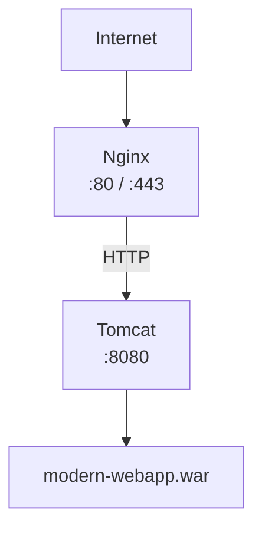
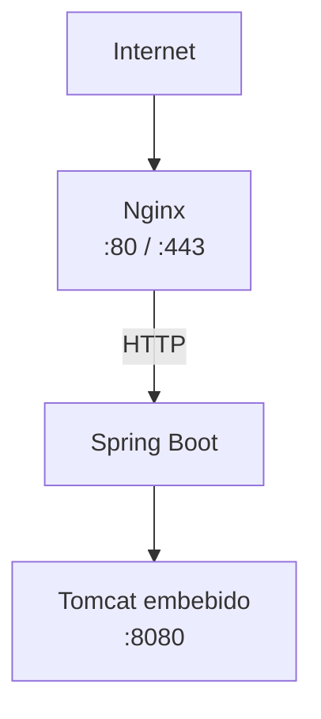

# Práctica 3.2: Despliegue de aplicaciones Java con Apache Tomcat

## Aplicación a desplegar

La aplicación Java web que desplegaremos en esta práctica está disponible en el repositorio:

[https://github.com/raul-profesor/java-dashboard](https://github.com/raul-profesor/java-dashboard)

Este repositorio contiene un proyecto Maven que genera un archivo `.war` (Web Application Archive) con un dashboard que muestra información del sistema, memoria JVM, hora del servidor, y una calculadora simple.

## Objetivos

- Comprender la arquitectura de una aplicación Java web y el rol de Tomcat como **servlet container**.
- Instalar OpenJDK y Apache Tomcat desde cero en Ubuntu.
- Configurar Tomcat como servicio de **systemd** con usuario dedicado.
- Descargar, compilar y empaquetar una aplicación Java web con Maven para generar un artefacto `.war`.
- Desplegar la aplicación en Tomcat y verificar su funcionamiento.
- Configurar **Nginx como reverse proxy** delante de Tomcat.
- Comparar el modelo tradicional (WAR + Tomcat externo) con el modelo moderno (JAR + Tomcat embebido).

---

## Visión global del despliegue

Este despliegue sigue un flujo lógico donde cada paso construye sobre el anterior:

1. **Instalar Java**: Necesitamos la JVM porque tanto Tomcat como la aplicación Java requieren un entorno de ejecución Java.
2. **Crear usuario dedicado**: Por seguridad, ejecutamos Tomcat con permisos mínimos, no como root.
3. **Instalar Tomcat**: Descargamos e instalamos el contenedor de servlets que ejecutará nuestra aplicación web.
4. **Configurar systemd**: Automatizamos el arranque de Tomcat para que se inicie con el sistema y se reinicie en caso de fallos.
5. **Compilar la aplicación**: Usamos Maven para descargar dependencias, compilar el código fuente y empaquetarlo en un `.war`.
6. **Desplegar el WAR**: Copiamos el artefacto compilado a Tomcat, que lo detecta y despliega automáticamente.
7. **Configurar Nginx**: Añadimos una capa de reverse proxy para mejorar seguridad, rendimiento y flexibilidad.

Cada paso es necesario: sin Java no hay JVM, sin Tomcat no hay contenedor de servlets, sin systemd no hay automatización, sin Maven no hay compilación, y sin Nginx exponemos directamente el backend.

---

## Arquitectura que vamos a montar

### Opción A: Tomcat tradicional (Práctica 2.2a)



Tomcat actúa como **contenedor de servlets**: recibe las peticiones HTTP, las enruta al servlet correspondiente y genera la respuesta.

### Opción B: Spring Boot con Tomcat embebido (Práctica 2.2b)



En este modelo, **Tomcat vive dentro del propio JAR**. No hay un Tomcat externo que administrar.

> **Concepto clave**: En ambos casos hay una JVM y hay Tomcat. Lo que cambia es **quién controla el ciclo de vida** de Tomcat.
>
> - **Tradicional**: `systemd → Tomcat → aplicación.war`
> - **Spring Boot**: `systemd → java -jar app.jar → Tomcat embebido`

---

## Parte A: Despliegue tradicional (WAR + Tomcat externo)

### Paso 1: Instalar OpenJDK

Tomcat necesita una JVM (Java Virtual Machine) para ejecutarse. En Ubuntu instalamos OpenJDK:

```bash
sudo apt update
sudo apt install -y openjdk-21-jdk
```

> **Nota**: Tomcat 11 requiere Java 17 o superior. **OpenJDK 21 LTS** es la versión recomendada para producción por ser una versión de soporte a largo plazo.

Verifica la instalación:

```bash
java -version
```

Deberías ver algo como:

```
openjdk version "21.0.x"
OpenJDK Runtime Environment (build 21.0.x)
OpenJDK 64-Bit Server VM (build 21.0.x, mixed mode, sharing)
```

Y el compilador:

```bash
javac -version
```

```
javac 21.0.x
```

**Concepto**: `java` es el intérprete de la JVM (ejecuta bytecode `.class`). `javac` es el compilador que convierte el código fuente `.java` en bytecode `.class`.

---

### Paso 2: Crear un usuario dedicado para Tomcat

No debemos ejecutar Tomcat como `root`. Por seguridad, creamos un **usuario de sistema**:

```bash
sudo useradd \
    --system \
    --home /opt/tomcat \
    --shell /usr/sbin/nologin \
    tomcat
```

| Opción | Significado |
|---|---|
| `--system` | Crea un usuario de sistema (no aparece en el login normal) |
| `--home /opt/tomcat` | Directorio home del usuario |
| `--shell /usr/sbin/nologin` | Impide que el usuario pueda iniciar sesión |

Verifica que se ha creado:

```bash
id tomcat
```

```
uid=999(tomcat) gid=999(tomcat) groups=999(tomcat)
```

**Concepto**: Ejecutar servicios con el mínimo privilegio necesario es un **principio fundamental de seguridad**. Si Tomcat se ve comprometido, el atacante solo tendrá los permisos del usuario `tomcat`, no de `root`.

---

### Paso 3: Descargar Apache Tomcat

Tomcat es un proyecto de Apache. En producción preferimos descargarlo directamente desde Apache en lugar de usar el paquete del sistema operativo, porque nos da más control sobre la versión y la ubicación de instalación.

```bash
cd /tmp
wget https://dlcdn.apache.org/tomcat/tomcat-11/v11.0.24/bin/apache-tomcat-11.0.24.tar.gz
```

> **Versión**: Tomcat 11 es la rama actual. Implementa las especificaciones **Jakarta EE 11** (servlets 6.1, JSP 4.0). La diferencia clave con Tomcat 9 es el cambio de namespace `javax.*` → `jakarta.*`.

---

### Paso 4: Instalar Tomcat en `/opt/tomcat`

Creamos el directorio de instalación:

```bash
sudo mkdir -p /opt/tomcat
```

Descomprimimos el archivo descargado:

```bash
sudo tar xzf apache-tomcat-11.0.24.tar.gz \
    -C /opt/tomcat \
    --strip-components=1
```

| Parámetro | Función |
|---|---|
| `xzf` | eXtract, decompress (gzipped), desde File |
| `-C /opt/tomcat` | Extraer en ese directorio |
| `--strip-components=1` | Elimina el primer nivel del path (evita crear `/opt/tomcat/apache-tomcat-11.0.24/`) |

#### Estructura de directorios de Tomcat

```
/opt/tomcat/
├── bin/          ← Scripts de arranque y parada (startup.sh, shutdown.sh)
├── conf/         ← Configuración (server.xml, web.xml, tomcat-users.xml)
├── lib/          ← Librerías compartidas (JARs de Tomcat)
├── logs/         ← Logs de Tomcat (catalina.out, localhost.log, etc.)
├── temp/         ← Archivos temporales
├── webapps/      ← Aquí se despliegan las aplicaciones (.war)
└── work/         ← Directorio de trabajo (compilación JSP → Servlet)
```

**Concepto**: Tomcat distingue entre:
- **`CATALINA_HOME`**: Donde está instalada la distribución de Tomcat (`/opt/tomcat`).
- **`CATALINA_BASE`**: Donde están los datos de una instancia concreta (permite tener varias instancias compartiendo la misma instalación).

En esta práctica ambas apuntan al mismo directorio.

---

### Paso 5: Asignar permisos

Cambiamos el propietario de todo el directorio de Tomcat al usuario `tomcat`:

```bash
sudo chown -R tomcat:tomcat /opt/tomcat
```

Aseguramos que los scripts sean ejecutables:

```bash
sudo chmod +x /opt/tomcat/bin/*.sh
```

**Concepto**: Los scripts en `bin/` necesitan permiso de ejecución para que systemd pueda arrancar Tomcat. El resto de directorios solo necesitan lectura/escritura para el usuario `tomcat`.

---

### Paso 6: Probar Tomcat manualmente

Antes de configurar systemd, verificamos que Tomcat arranca correctamente:

```bash
sudo -u tomcat /opt/tomcat/bin/startup.sh
```

Comprobamos que el puerto 8080 está escuchando:

```bash
ss -lntp | grep 8080
```

```
LISTEN  0  100  :::8080  :::*  LISTEN  12345/java
```

Verificamos que responde:

```bash
curl -s -o /dev/null -w "%{http_code}" http://localhost:8080
```

Debe devolver `200`.

Ahora paramos Tomcat para configurar systemd:

```bash
sudo -u tomcat /opt/tomcat/bin/shutdown.sh
```

**Concepto**: Esta prueba manual nos permite detectar errores de configuración (JAVA_HOME, permisos, puertos) antes de introducir la complejidad de systemd.

---

### Paso 7: Crear el servicio systemd

En un servidor moderno **no queremos arrancar Tomcat manualmente**. Usamos **systemd** para que:
- Arranque automáticamente al iniciar el sistema.
- Se reinicie si falla (`Restart=on-failure`).
- Gestione logs con `journalctl`.

Creamos el fichero de servicio:

```bash
sudo nano /etc/systemd/system/tomcat.service
```

Contenido:

```ini
[Unit]
Description=Apache Tomcat
After=network.target

[Service]
Type=forking

User=tomcat
Group=tomcat

Environment="JAVA_HOME=/usr/lib/jvm/java-21-openjdk-amd64"
Environment="CATALINA_HOME=/opt/tomcat"
Environment="CATALINA_BASE=/opt/tomcat"

ExecStart=/opt/tomcat/bin/startup.sh
ExecStop=/opt/tomcat/bin/shutdown.sh

Restart=on-failure

[Install]
WantedBy=multi-user.target
```

| Directiva | Significado |
|---|---|
| `After=network.target` | Espera a que la red esté disponible antes de arrancar |
| `Type=forking` | El proceso padre se bifurca (startup.sh lanza la JVM y termina) |
| `User/Group` | Ejecuta como el usuario y grupo `tomcat` |
| `Environment` | Variables de entorno (JAVA_HOME, CATALINA_HOME, CATALINA_BASE) |
| `ExecStart` | Comando que systemd ejecuta para arrancar el servicio |
| `ExecStop` | Comando que systemd ejecuta para parar el servicio |
| `Restart=on-failure` | Reinicia automáticamente si el proceso termina con error |
| `WantedBy=multi-user.target` | Se activa en el nivel de ejecución multi-usuario (runlevel 3) |

> **Nota sobre JAVA_HOME**: La ruta `/usr/lib/jvm/java-21-openjdk-amd64` puede variar según la versión exacta. Verifícala con `ls /usr/lib/jvm/`.

Recargamos la configuración de systemd:

```bash
sudo systemctl daemon-reload
```

Activamos el servicio para que arranque al inicio:

```bash
sudo systemctl enable tomcat
```

Arrancamos Tomcat:

```bash
sudo systemctl start tomcat
```

Verificamos el estado:

```bash
sudo systemctl status tomcat
```

Deberías ver `active (running)`.

Consultar logs en tiempo real:

```bash
journalctl -u tomcat -f
```

---

### Paso 8: Descargar y construir la aplicación con Maven

Ahora vamos a descargar la aplicación desde GitHub y compilarla para generar el `.war`.

#### Clonar el repositorio

Primero clonamos el proyecto desde GitHub:

```bash
cd /tmp
git clone https://github.com/raul-profesor/java-dashboard.git
cd java-dashboard
```

> **Nota**: Este repositorio contiene una aplicación Java web completa con un dashboard que muestra información del sistema, memoria JVM, hora del servidor, y una calculadora.

#### Estructura del proyecto Maven

El proyecto sigue la estructura estándar de Maven:

```
java-dashboard/
├── pom.xml                 ← Descriptor del proyecto Maven (Project Object Model)
└── src/
    └── main/
        ├── java/           ← Código fuente Java (.java)
        │   └── com/example/webapp/
        │       └── HomeServlet.java
        ├── resources/      ← Archivos de configuración (properties, XML)
        └── webapp/         ← Recursos web (JSPs, HTML, CSS, JS)
            ├── index.jsp
            └── WEB-INF/
                └── web.xml
```

**Concepto**: Maven organiza el proyecto de forma estandarizada. Esta estructura permite que cualquier desarrollador o herramienta entienda dónde está el código fuente, los recursos y la configuración. La carpeta `src/main/java` contiene el código Java, `src/main/webapp` contiene los recursos web (JSPs, HTML, CSS), y `pom.xml` describe las dependencias y cómo construir el proyecto.

#### `pom.xml` — Descriptor del proyecto Maven

El fichero `pom.xml` es el corazón de Maven. Define qué dependencias necesita el proyecto, cómo compilarlo y qué artefacto generar. Vamos a ver las partes clave:

```xml
<project xmlns="http://maven.apache.org/POM/4.0.0">
    <modelVersion>4.0.0</modelVersion>

    <!-- Coordenadas del proyecto: identifican único al artefacto -->
    <groupId>com.example</groupId>           <!-- Organización o grupo -->
    <artifactId>modern-webapp</artifactId>   <!-- Nombre del proyecto -->
    <version>1.0</version>                    <!-- Versión -->
    <packaging>war</packaging>                <!-- Tipo de artefacto: WAR (Web Application Archive) -->

    <!-- Propiedades de compilación -->
    <properties>
        <maven.compiler.source>21</maven.compiler.source>   <!-- Versión de Java fuente -->
        <maven.compiler.target>21</maven.compiler.target>   <!-- Versión de Java objetivo -->
    </properties>

    <!-- Dependencias: librerías que necesita el proyecto -->
    <dependencies>
        <dependency>
            <groupId>jakarta.servlet</groupId>
            <artifactId>jakarta.servlet-api</artifactId>
            <version>6.0.0</version>
            <scope>provided</scope>
        </dependency>
    </dependencies>

    <!-- Configuración de compilación -->
    <build>
        <finalName>modern-webapp</finalName>  <!-- Nombre del WAR final sin versión -->
    </build>
</project>
```

**Explicación de los elementos clave**:

- **`groupId`, `artifactId`, `version`**: Son las coordenadas Maven que identifican de forma única el artefacto. Piensa en esto como un DNI para tu proyecto. Por ejemplo, `com.example:modern-webapp:1.0`.

- **`packaging=war`**: Indica que el resultado final será un archivo `.war` (Web Application Archive). Maven podría generar JARs, WARs, EARs, etc. Para aplicaciones web, usamos WAR.

- **`dependencies`**: Lista de librerías externas que el proyecto necesita. En este caso, necesitamos la API de servlets Jakarta EE para poder crear servlets.

- **`scope=provided`**: Esta dependencia la proporciona el contenedor (Tomcat), **no se incluye en el WAR**. Tomcat ya tiene su propia implementación de la API de servlets, así que no necesitamos empaquetarla. Si la incluyéramos, habría conflictos de versiones.

- **`finalName`**: Define el nombre del artefacto final. En lugar de `modern-webapp-1.0.war`, generará `modern-webapp.war`. Esto es importante porque el nombre del WAR determina la URL de la aplicación (`/modern-webapp/`).

**Concepto**: El `pom.xml` actúa como un "Makefile" inteligente. Maven lee este fichero, descarga automáticamente las dependencias desde repositorios centrales (Maven Central), compila el código, ejecuta tests (si los hay), y empaqueta todo en el formato especificado. Todo esto con un solo comando.

#### `HomeServlet.java` — El servlet principal

```java
@WebServlet("/")
public class HomeServlet extends HttpServlet {
    @Override
    protected void doGet(HttpServletRequest request,
                         HttpServletResponse response) {
        request.setAttribute("serverTime", LocalDateTime.now());
        request.getRequestDispatcher("/index.jsp")
                .forward(request, response);
    }
}
```

| Concepto | Explicación |
|---|---|
| `@WebServlet("/")` | Anotación que mapea el servlet a la ruta raíz (`/`) |
| `extends HttpServlet` | Hereda de la clase base de servlets HTTP |
| `doGet()` | Maneja las peticiones HTTP GET |
| `request.setAttribute()` | Pasa datos al JSP para que los muestre |
| `forward()` | Delega la respuesta al JSP |

**Concepto**: Un **servlet** es una clase Java que extiende `HttpServlet` y procesa peticiones HTTP. Tomcat instancia el servlet y llama a sus métodos `doGet()`, `doPost()`, etc. La anotación `@WebServlet` registra el servlet automáticamente sin necesidad de configurarlo en `web.xml`.

#### Compilar el proyecto

```bash
cd java-proyecto
mvn clean package
```

| Fase | Acción |
|---|---|
| `clean` | Elimina el directorio `target/` (limpieza de compilaciones anteriores) |
| `compile` | Compila el código fuente `.java` a bytecode `.class` |
| `test` | Ejecuta las pruebas unitarias (si las hay) |
| `package` | Empaqueta el resultado en el formato definido (`war`) |

Resultado:

```
target/
├── classes/              ← Bytecode .class compilado
├── modern-webapp/        ← WAR desempaquetado
└── modern-webapp.war     ← Artefacto final para desplegar
```

**Concepto**: Un archivo `.war` es esencialmente un `.zip` con una estructura específica que Tomcat puede desplegar automáticamente. Contiene los `.class`, JSPs, `web.xml` y recursos estáticos.

---

### Paso 9: Desplegar el WAR en Tomcat

Copiamos el WAR al directorio de despliegue de Tomcat:

```bash
sudo cp /tmp/java-dashboard/target/modern-webapp.war /opt/tomcat/webapps/
```

Tomcat detectará automáticamente el nuevo WAR y lo desplegará:

```
/opt/tomcat/webapps/
├── modern-webapp.war
└── modern-webapp/        ← Desplegado automáticamente
    ├── index.jsp
    ├── META-INF/
    └── WEB-INF/
        ├── classes/
        └── web.xml
```

La aplicación será accesible en:

```
http://<IP_SERVIDOR>:8080/modern-webapp/
```

Verificamos:

```bash
curl -s http://localhost:8080/modern-webapp/ | head -20
```

Deberías ver el HTML de la página.

**Concepto**: El **auto-deploy** de Tomcat consiste en:
1. Detectar un nuevo archivo `.war` en `webapps/`.
2. Descomprimirlo en un directorio con el mismo nombre.
3. Registrar la aplicación y hacerla accesible en el contexto correspondiente (`/modern-webapp/`).

---

### Paso 10: Configurar Nginx como reverse proxy

No exponemos Tomcat directamente en el puerto 8080. Usamos **Nginx como reverse proxy** para:

- Terminar las conexiones TLS (HTTPS).
- Balancear carga entre varios backends.
- Servir archivos estáticos directamente (mejor rendimiento).
- Añadir cabeceras de seguridad.
- Ocultar los detalles del backend al cliente.

Instalamos Nginx:

```bash
sudo apt install -y nginx
```

Creamos la configuración del sitio:

```bash
sudo nano /etc/nginx/sites-available/tomcat
```

```nginx
server {
    listen 80;
    server_name _;

    access_log /var/log/nginx/tomcat.access.log;
    error_log /var/log/nginx/tomcat.error.log;

    location / {
        proxy_pass http://127.0.0.1:8080;
        proxy_set_header Host $host;
        proxy_set_header X-Real-IP $remote_addr;
        proxy_set_header X-Forwarded-For $proxy_add_x_forwarded_for;
        proxy_set_header X-Forwarded-Proto $scheme;
    }
}
```

| Directiva | Función |
|---|---|
| `proxy_pass` | Reenvía la petición a Tomcat en localhost:8080 |
| `Host $host` | Envía el host original al backend |
| `X-Real-IP` | Informa a Tomcat de la IP real del cliente |
| `X-Forwarded-For` | Cadena de proxies por los que pasó la petición |
| `X-Forwarded-Proto` | Protocolo original (http o https) |

Activamos el sitio:

```bash
sudo ln -s /etc/nginx/sites-available/tomcat /etc/nginx/sites-enabled/
sudo rm -f /etc/nginx/sites-enabled/default
sudo nginx -t
sudo systemctl restart nginx
```

Ahora la aplicación es accesible en:

```
http://<IP_SERVIDOR>/modern-webapp/
```

---

### Paso 11: Verificación completa

Accede a `http://<IP_SERVIDOR>/modern-webapp/` en el navegador. Deberías ver el **Modern WebApp Dashboard** con:

- Tarjeta de versión de Java
- Tarjeta de sistema operativo
- Tarjeta de hostname
- Tarjeta de memoria JVM (MB usados / totales)
- Hora del servidor
- UUID generado por Java (con enlace para regenerar)
- Calculadora de suma (se ejecuta en el servidor Java)
- Alerta de estado: "Aplicación funcionando correctamente sobre Apache Tomcat"

Prueba la calculadora: introduce dos números y pulsa "Calcular". La suma se ejecuta en el servidor Java mediante el servlet.

Refresca la página para ver un nuevo UUID generado y la hora actualizada.

---

## Parte B: Comparativa de modelos de despliegue

### ¿Qué cambia respecto al modelo tradicional?

| Aspecto | Tradicional (WAR) | Spring Boot (JAR) |
|---|---|---|
| Artefacto | `.war` | `.jar` |
| Tomcat | Externo (instalado en el servidor) | Embebido (dentro del JAR) |
| Ciclo de vida | Tomcat administra las aplicaciones | La aplicación arranca su propio Tomcat |
| Despliegue | Copiar WAR en `webapps/` | Copiar JAR en `/opt/app/` |
| Múltiples apps | Comparten el mismo Tomcat | Cada app tiene su proceso independiente |
| Configuración | `server.xml`, `web.xml` | `application.properties` |
| Paradigma | Contenedor compartido | Proceso independiente (microservicio) |

### Diferencia fundamental

**Modelo tradicional**:

```
systemd → Tomcat → app1.war, app2.war, app3.war
```

Una sola JVM, un solo Tomcat, múltiples aplicaciones compartiendo recursos.

**Modelo Spring Boot**:

```
systemd → java -jar app1.jar → Tomcat embebido
systemd → java -jar app2.jar → Tomcat embebido
systemd → java -jar app3.jar → Tomcat embebido
```

Cada aplicación tiene su propia JVM y su propio Tomcat. Aislamiento total.

**Spring Boot no ha eliminado Tomcat**. Tomcat sigue estando ahí, pero **vive dentro de la aplicación y su ciclo de vida lo controla Spring Boot**.

### ¿Cuándo usar cada modelo?

| Modelo | Cuándo tiene sentido |
|---|---|
| **WAR + Tomcat externo** | Aplicaciones legacy, servidor Tomcat compartido, organización con plataforma Java establecida, múltiples aplicaciones WAR |
| **JAR + Spring Boot** | Aplicaciones nuevas, microservicios, despliegue en contenedores (Docker/Kubernetes), CI/CD, aislamiento entre aplicaciones |

---

## Comandos de referencia rápida

| Acción | Comando |
|---|---|
| Verificar Java | `java -version && javac -version` |
| Verificar usuario tomcat | `id tomcat` |
| Arrancar Tomcat manualmente | `sudo -u tomcat /opt/tomcat/bin/startup.sh` |
| Parar Tomcat manualmente | `sudo -u tomcat /opt/tomcat/bin/shutdown.sh` |
| Estado del servicio | `sudo systemctl status tomcat` |
| Reiniciar Tomcat | `sudo systemctl restart tomcat` |
| Logs de systemd | `journalctl -u tomcat -f` |
| Logs de catalina | `tail -f /opt/tomcat/logs/catalina.out` |
| Puerto 8080 | `ss -lntp \| grep 8080` |
| Compilar WAR | `mvn clean package` |
| Desplegar WAR | `sudo cp target/modern-webapp.war /opt/tomcat/webapps/` |
| Ver apps desplegadas | `ls /opt/tomcat/webapps/` |
| Test Nginx | `sudo nginx -t` |
| Logs Nginx | `sudo tail -f /var/log/nginx/tomcat.error.log` |

---

## Diagnóstico rápido

| Problema | Causa probable | Solución |
|---|---|---|
| `java: command not found` | JDK no instalado | `sudo apt install openjdk-21-jdk` |
| Tomcat no arranca | JAVA_HOME incorrecto | Verificar ruta con `ls /usr/lib/jvm/` y corregir en `tomcat.service` |
| Puerto 8080 no escucha | Tomcat no inició | `journalctl -u tomcat` para ver el error |
| 404 en `/modern-webapp/` | WAR no desplegado | Verificar `ls /opt/tomcat/webapps/` y logs |
| Error 502 en Nginx | Tomcat no corre | `sudo systemctl status tomcat` |
| WAR no se auto-despliega | `autoDeploy` desactivado | Revisar `Host autoDeploy` en `conf/server.xml` |
| Permiso denegado en `bin/` | Sin permiso de ejecución | `sudo chmod +x /opt/tomcat/bin/*.sh` |
| Clase no encontrada | `jakarta.servlet-api` sin `scope=provided` | Añadir `<scope>provided</scope>` en `pom.xml` |


